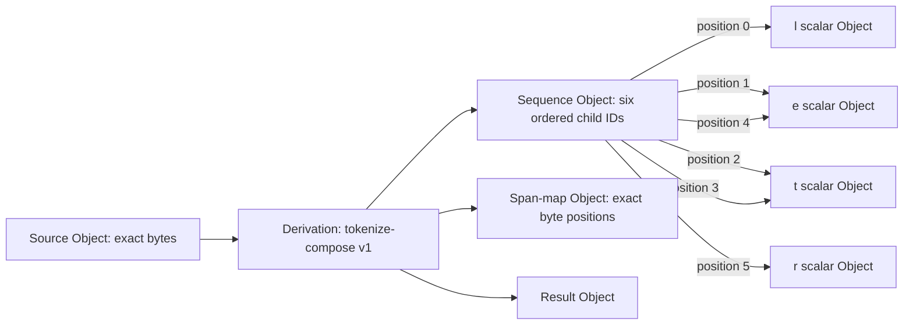

# M1.2 saved Unicode sequence artifacts

Created and verified **30 October 2026**. These are developer engineering fixtures, with `learner_ingestion_allowed: false`; the string `letter` has no taught meaning in this build.

| Directory | Exact source | Outcome | Objects / Relations / Derivations | Canonical pack bytes |
|---|---|---|---|---:|
| [letter](letter/report.json) | UTF-8 `letter` | Accepted: 6 positions, 4 distinct scalar Objects | 41 / 6 / 1 | 18,555 |
| [combining](combining/report.json) | `e` followed by U+0301 | Accepted: 2 scalar positions; no normalization | 39 / 2 / 1 | 16,748 |
| [mixed](mixed/report.json) | `A`, U+00E9, U+1F600, `e`, U+0301, U+0558 | Accepted: mixed byte widths including a Unicode 18 addition | 43 / 6 / 1 | 18,859 |
| [rejected-utf8](rejected-utf8/report.json) | Bytes `41 FF` | Rejected at byte interval `[1,2)`; source preserved | 35 / 0 / 1 | 15,115 |

Each directory contains:

- `records.bin`: canonical Object, Relation and Derivation records in ID order.
- `registry.json`: the finite text-profile and Unicode declaration mappings.
- `report.json`: the replay-derived result and content identities.
- `manifest.json`: hashes and byte lengths for the canonical pack, registry and report.
- `index.sqlite`: a rebuildable lookup from record ID to family, frame offset and wire length.

The `letter` bundle includes 30 declaration Objects, four selected Unicode scalar Objects with their original M1.1 identities, and seven source/sequence/span/result/operation/rule/relation-type Objects. The six membership Relations preserve the two occurrences of `t` and the two occurrences of `e`. One deterministic Derivation records the source, ordered scalar inputs and outputs.

Sequence ID:

```text
471b04f92e321630ddc43d80e84b8fe37b395fd1cbeda662a7dbdbe86e4cad1c
```



Inspect and verify from the repository root:

```sh
.venv/bin/python -m tools.unicode_sequences inspect
.venv/bin/python -m tools.unicode_sequences verify
.venv/bin/python -m tools.unicode_sequences inspect --id 471b04f92e321630ddc43d80e84b8fe37b395fd1cbeda662a7dbdbe86e4cad1c
```

Reconstruction writes to a new file and refuses to overwrite it. Use the commands in the [implementation guide](../../../../docs/UNICODE_SEQUENCES.md) for fresh destinations, byte export and index recovery. Rejected input requires explicit `--source-only` export; it cannot masquerade as a successful sequence.

All four artifacts were independently rebuilt through the CLI in fresh processes. Their canonical pack, registry, report and manifest bytes matched exactly. The [golden fixture](../../../../fixtures/unicode-sequences-v1/golden.json) and [build receipt](../../../../manifests/m1-2-verification.json) record results. SQLite is prototype lookup infrastructure here; Neo4j integration is pending.

Publication is bounded and verified before rename. A hard exit can leave a sibling `.lock` or `.stage-*` directory requiring manual inspection and cleanup before retry. Existing published artifacts remain readable and verifiable. No active-instance history, learned meaning, dictionary entry or neural vocabulary is created by these demonstrations.
