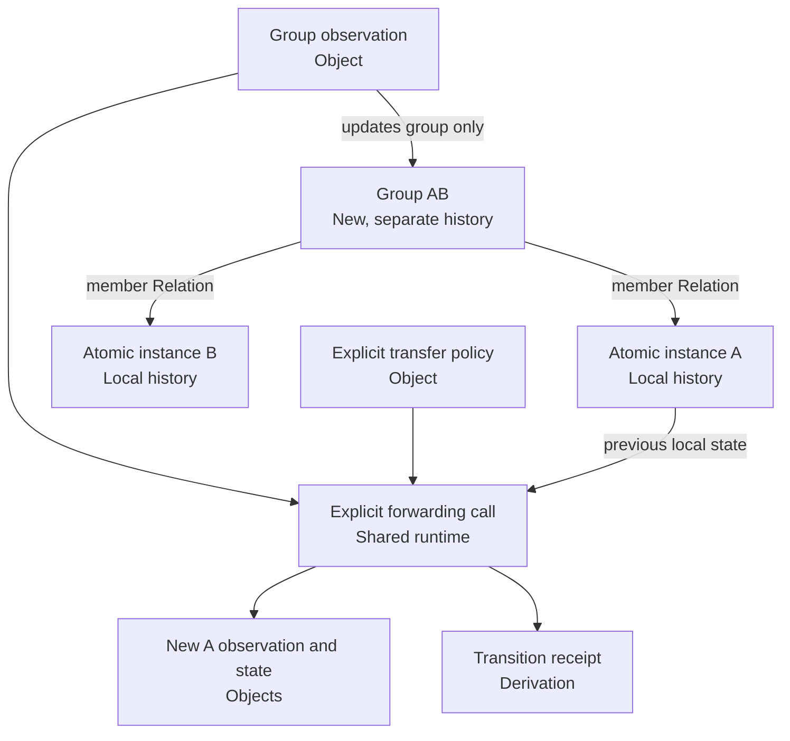

# M0.2: scoped active objects

Implemented **30 October 2026** after explicit approval. This is a bounded operation-execution prototype under M0, using the M1.1 Unicode collection and preparing for the M2 interaction harness. It does not complete those milestones.

The user's term **limited sentience scope** is implemented as **instance-scoped observation history and state**. Subjective experience, its possible usefulness, and whether it could emerge remain open research questions. Counters, memory, identity comparisons and recorded self-references do not establish that experience. No language learning, learned reasoning, biological cells or autonomous rule improvement is claimed.

## The scope rule

An immutable Unicode scalar Object identifies a symbol. An active atomic instance binds that symbol to a run, an instance name and execution budgets. Each instance has its own versioned state. Two instances referencing the same scalar have independent histories.

A group is another typed Object with an ordered, immutable list of 2–64 distinct atomic-instance members. Membership creates explicit Relations and commits the order in the group's payload. It creates a new scope with zero observations; it does not inherit or erase member histories. The group's initial identity-comparison rule checks whether the observed symbol equals any member's symbol. It reads member identities, not member experience or counters.

Group events update only the group. Member events update only that member. Creating a connection or transfer policy does not execute a transfer. A group observation reaches an atomic member only when the caller explicitly creates a group-to-member policy and invokes the forwarding operation for a committed observation receipt. The receiver applies its own identity-comparison rule. A group match can therefore become a member mismatch.

The forwarded observation retains the source observation ID, root evidence ID, policy ID and a reference Object for the source Derivation. It is a derived delivery of the same evidence, not an independent witness. Repeating that forwarding request returns the original receipt and cannot count twice. There is one deterministic policy per group/member pair; conflicting reuse of an event key is rejected.



## Exactly three persistent primitives

| Primitive | Implemented use |
|---|---|
| Object | Unicode scalar, declaration, registry, run, operation, rule, instance, state, observation, result, transfer policy, command and receipt reference |
| Relation | Ordered member, symbol, state-of, supersedes, observes and derived-from connections |
| Derivation | Deterministic operation receipt with ordered typed inputs/outputs, operation ID, rule ID/version and profile parameters |

All Object records carry the existing type/definition/schema handles and payload. The `sovereign-active-objects-v1` registry extension contains declaration Objects for its types and includes the original Unicode declarations. The existing Unicode registry and content IDs are unchanged. The registry is itself an Object. Operations are registered Python functions with explicit contracts; naming a rule does not make arbitrary text executable.

Nested reference fields, JSON authoring syntax, SQLite tables and the executor are implementation mechanisms, not additional persistent primitives. Relation endpoints are always Object IDs. A Derivation is discussed through a `receipt-reference` Object when an Object reference is required.

## Operations and bounds

The API is `Store.submit(action, **arguments)`. Only these operations are accepted:

| Action | Arguments | Behavior |
|---|---|---|
| `atom` | `name`, `scalar`, `max_steps`, `memory_limit` | Bind an assigned Unicode scalar and initialize an empty local state |
| `group` | `name`, ordered `members`, `max_steps`, `memory_limit` | Create a new group scope from existing active atoms |
| `allow_forward` | `group`, `member` | Declare an explicit, nonautomatic group-to-member observation policy |
| `observe` | `instance`, `event`, `source`, `scalar` | Compare identity and append one local observation/state/result |
| `forward` | `policy`, `receipt` | Deliver one committed group observation to its authorized member and reinterpret it locally |

IDs are lowercase 64-character hexadecimal strings. Scalars are integers, excluding booleans, and must exist in the pinned Unicode collection. Names, event keys and source labels use 1–120 ASCII letters/digits or `_ . : -`. Labels describe engineering requests and confer no teacher authority.

There are at most 64 active instances per store. The run command limit is configurable up to 4,096. An instance step limit is at most 4,096, and its memory capacity is at most 256 observations; reaching either limit rejects the next transition atomically. The demo uses 16 for both instance limits. Memory is not silently evicted. Existing codec limits still apply, including 1 MiB per record and 4,096 references per Derivation.

Groups are flat in this slice. Nested groups, changing membership, retirement, rule learning, confidence updates, automatic propagation, feedback assessment and cross-run transfer remain future work. A group is a composition of active instances, not an in-place conversion that destroys its atoms. An updated composition requires a new explicitly named instance.

## Storage and replay

The saved demonstration is in [data/experiments/active-objects/m0-2](../data/experiments/active-objects/m0-2/README.md).

- `records.sqlite`: canonical bytes and IDs for **99 Objects, 26 Relations and 10 Derivations**. The Object count includes declarations and the small referenced Unicode subset; it does not replace the full Unicode collection.
- `report.json`: an immutable build-result snapshot with before/after state IDs, counters, receipt IDs, scope checks and restart/replay results. Inspect the store for current state after additional commands.

The `records` table is authoritative for this prototype. Its `kind` column admits only `object`, `relation` and `derivation`. `commands`, `instances` and `requests` are derived indexes; `metadata` points to the genesis run Object. Each canonical command Object commits to its ordinal, predecessor, run and arguments. Every operation atomically commits its records, receipt and index changes in one SQLite transaction with synchronous writes. `BEGIN IMMEDIATE` serializes writers; deployment remains a local prototype with a coordinating caller, not a distributed execution system.

Opening a store verifies it before use. Verification holds a consistent transaction, checks record decoding/identity/declarations/references, rebuilds the run in memory by executing canonical commands, and compares the complete canonical record set and all indexes. This rejects hash-valid states or receipts that were not produced by the declared operations. The indexes are reconstructible by that replay; a standalone repair/export command is not implemented.

The run name and configuration define a reproducible namespace. Using the same name/configuration and commands in two files reproduces the same logical run, not two independent sources of evidence. Use a distinct run name when creating a distinct run through `Store.create`.

The original [Unicode collection](../data/objects/unicode/18.0.0/README.md) remains in its existing location. The active store embeds only the selected scalar records with the same canonical identities. Replay checks those scalars against the local collection and pins its canonical-pack hash.

## Run and inspect

From the project root:

```sh
uv run --locked python -m tools.active_objects verify
uv run --locked python -m tools.active_objects inspect --name atom-a
uv run --locked python -m tools.active_objects inspect --name group-ab
```

Inspect any actual Object, Relation or Derivation by passing its ID from the report or inspector:

```sh
uv run --locked python -m tools.active_objects record --id ACTUAL_64_CHARACTER_ID
```

Create a separate demonstration in a destination that does not already exist:

```sh
uv run --locked python -m tools.active_objects demo --directory .cache/my-active-demo
```

To submit an explicit operation, write a JSON request with exactly `action` and `arguments` fields, following the operation table, then run:

```sh
uv run --locked python -m tools.active_objects apply \
  --directory .cache/my-active-demo --request /absolute/path/to/request.json
```

The CLI is engineering tooling. It neither understands English instructions nor manufactures teacher seeds. The run and fixtures are labeled `learner_ingestion_allowed: false`; a future ingestion system must enforce that boundary. No learner ingestion subsystem exists yet.

## Completion evidence

The demonstration follows A, B, A for atom A, then A and C for group AB. Atom A remains at 3 observations/2 matches during group activity. Group AB reaches 2 observations/1 match. Explicit forwarding of the group's A observation moves atom A to 4 observations/3 matches; atom B stays at 0/0. The group's state does not change during forwarding.

The [tests](../tests/test_active_objects.py) check expected outcomes independently of replay, scoped transfer, repeated observations, event idempotency, strict references, finite budgets, corruption detection, and hard process exits both before and after commit. After a post-commit exit, resubmission returns the committed receipt without repeating the update. Independent CLI builds reproduce the same complete record digest and pinned [engineering fixture](../fixtures/active-objects-v1/scoped-demo.json).

See the [verification receipt](../manifests/m0-2-verification.json) for test counts, hashes, dependency checks and reproduction results. One bounded OpenAI development review used 8,018 total tokens, with a 1,024 output-token ceiling. Its suggestions were reviewed locally: rollback-error preservation and post-commit response-loss coverage were adopted; claims that uppercase IDs were accepted or duplicate route policies could coexist were contradicted by the existing validation. Opening/replay checks already reject injected records. API output supplies no learner knowledge, authoritative grading or evidence of sentience.

The implementation uses the existing Python 3.11 environment and standard-library SQLite. It adds no package, model, database server, or production Rust integration. Neo4j remains the planned graph backend for a later approved slice.
