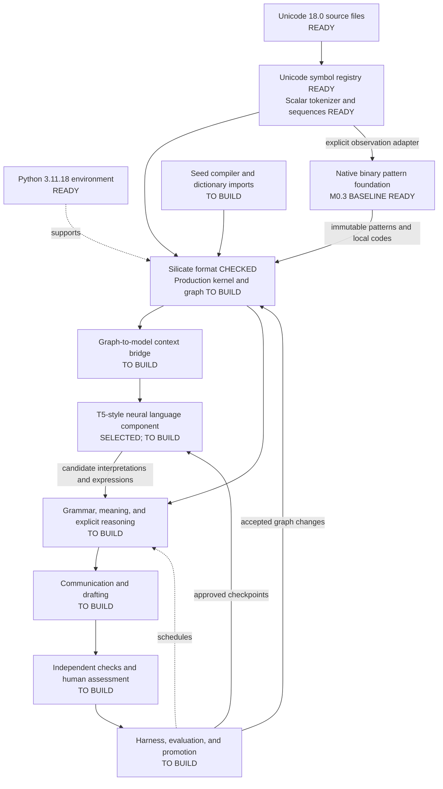
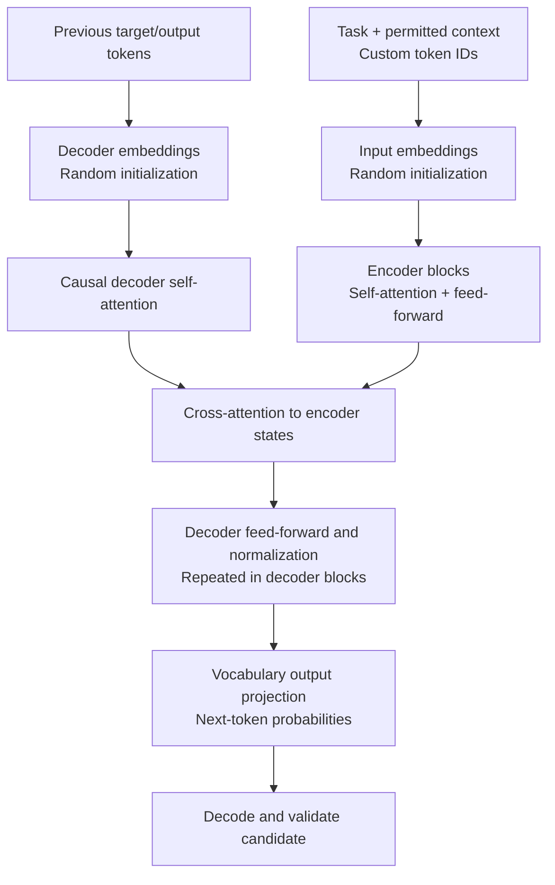

# SovereignAI architecture and implementation status

Snapshot: **30 October 2026**, plan version 0.3. The original environment and Unicode setup were completed on 29 October. This is a status explanation of the current plan, not a claim that the planned components exist. Update it when implementation evidence changes.

## Meaning of finalized

Use two separate questions for every layer: has its direction been selected, and has its implementation passed the relevant checks?

- **Established requirement:** a user-specified constraint, such as the three primitives or English before mathematics.
- **Selected direction:** the current engineering choice, such as Neo4j first or T5-style random initialization. Parameters and implementation can still be open.
- **Draft design:** responsibilities and candidate mechanisms are documented; algorithms, schemas, and acceptance details are not all fixed.
- **Implemented and checked:** working artifacts exist with validation evidence.
- **Deferred:** conditional later work, such as Spanner or mathematics after the English gate.

Completed work includes the Python environment, UCD/Unihan acquisition, the M0.1 checked format contract, M1.1 first-level Unicode Objects, and [M0.2 scoped active objects](ACTIVE_OBJECTS.md). M0.2 implements separate atom/group histories, explicit transfer, bounded operations, transactional storage, replay and restart. Planning documents and source reviews also exist. English-learning capabilities and subjective experience have not been demonstrated.

[M0.3](BINARY_FOUNDATION.md) now adds the binary internal-language foundation: native observations, scoped pattern candidates, association graphs, versioned local prefix codes, raw fallback and exact reconstruction/held-out prediction checks. Its read-only adapter connects one M0.2 history at a time. A working pattern baseline does not establish grounded meanings or English mastery.

The user's repeat source review confirmed unchanged public content. The [updated M0.3 alignment](BINARY_FOUNDATION.md#source-alignment-and-remaining-concept-learning-work) explicitly maps grounded concept formation, transformations, causal experiments and revision loops to remaining M2–M6 work. The six-stage baseline is complete within its approved bounds; the broader research architecture is partial.

**User-adopted scaling architecture, 30 October 2026:** exact integer metadata, explicit numerical formats, logical tensor Objects, separate chunk/storage representations and external streamed bytes are the foundation for later M0.3 improvements. The [scaling contract and roadmap mapping](BINARY_FOUNDATION.md#accepted-scaling-design-numeric-values-tensors-and-bulk-storage) are recorded; the tensor schemas, streaming backend and numerical engine remain unimplemented. Current prototype limits and existing build evidence remain unchanged.

The authorized [OpenAI development helper](DEVELOPMENT_ASSISTANCE.md) has also been implemented and verified. New builds follow [BUILD_WORKFLOW.md](BUILD_WORKFLOW.md). M0.1/M1.1/M0.2/M0.3/M1.2 were authorized and are complete as bounded slices; the rest of M0/M1 and subsequent milestones are not complete. [M1.2](UNICODE_SEQUENCES.md) supplies deterministic Unicode scalar tokenization, ordered composition, byte spans, replay and immutable local artifacts. It supplies no taught meanings or learned Unigram vocabulary.

Version 0.3 adds [twelve mathematical adaptations](MATHEMATICAL_EXTENSIONS.md) and a [draft experiment register](../experiments/mathematical_extensions.toml). All entries remain inactive. This is a design extension to the existing 18-layer inventory; it does not increase the number of completed implementation layers.

## Overall system

The arrows show planned information and control relationships. The environment, Unicode files and initial atom registry have implementation evidence. The format contract is checked; production kernel/graph integration and the cognitive components remain pending.

The graph, reasoning engine, and neural model are cooperating components. T5 does not replace Silicate, execute all graph operations, or certify its own output. The harness coordinates the loop, and accepted changes retain their evidence and version history.

**New harness candidate:** the user suggested Google Research's Harness² while this status report was being prepared. It is being considered for the outer strategy-improvement loop. Its upstream package requires Python 3.12/3.13 and keeps model weights fixed; it does not replace the Python 3.11 core or T5 training. No integration choice is finalized. See [HARNESS2_ASSESSMENT.md](HARNESS2_ASSESSMENT.md) for the reviewed fit and a diagram of the separate improvement loops.

## Layer inventory

| Layer | What is established or selected | What exists now | What remains pending |
|---|---|---|---|
| 1. Development environment | CPython 3.11.18, uv, exact dependency pins | Isolated environment and locked libraries; bounded OpenAI development helper with local checks and a verified request; setup script and receipts | Training framework and compute profiling when neural work starts; Rust build integration; implementation CI |
| 2. Unicode reference source | Unicode 18.0.0; scalar payloads preserve exact values | UCD/Unihan files, M1.1 importer and 310,341 scalar Objects; M1.2 pinned-repertoire lookup and exact byte spans | Normalization and grapheme-boundary conformance; wider runtime interfaces |
| 3. Silicate representation | Exactly Object, Relation, Derivation; Scratch V1/SHA256 format pinned | Strict codec, Rust-source fixtures, Unicode declarations, M0.2 executor, M0.3 binary registry/replay and M1.2 sequence declarations/replay | Production Rust kernel, general schema/domain interpreter and bridge; source vendoring/license clearance |
| 4. Tokenization and composition | Native binary internals; deterministic scalar text input; later learned words/phrases | M1.2 strict UTF-8 scalar tokenizer, ordered Sequence Objects, spans, Relations and replay; M0.3 binary pattern/codebook baseline | Normalization/grapheme views, longer/nested sequences, versioned learned segmentation and lexical/grammatical mapping |
| 5. Persistence | Neo4j for graph descriptors; external packed tensor blobs with versioned chunk manifests; Spanner conditional | M1.1 collection/index; M0.2 transactional store; M0.3 immutable artifacts; M1.2 staged publication, restore, replay and rebuildable SQLite lookup | Graph integration, numeric/tensor manifests, bounded streaming/blob adapter and broader backup/recovery tooling; hard-exit M1.2 locks require manual inspection |
| 6. Knowledge and evidence graphs | Logical views share Object/Relation/Derivation records; immutable history and versioned active state | M0.2 scoped histories/forwarding; M0.3 pattern evidence, root deduplication and within-observation association Relations | General semantic knowledge graphs, causal discovery, conflict handling and retrieval |
| 7. Foundations and source ingestion | Human subject seeds; approved open dictionaries; OEWN first and selected Wiktionary enrichment | Draft seed contracts and lexical-import design | Actual English seeds; seed compiler/interface; exact dictionary snapshots and downloads; source/license tracking; sense alignment; staged activation |
| 8. Language and meaning | Distinguish word form, sense, concept and referent; learn grammar and preserve ambiguity | English stages and candidate symbolic-learning mechanisms | Lexical binding, morphology, parser, grammar induction, semantic interpretation, grounding tasks, coreference and context handling |
| 9. Neural language component | Small T5-style model with random weights; explicit dtype/tensor descriptors and exact counts; symbolic baseline retained | Model direction and future tensor scaling design adopted | Framework, exact variant, dimensions, model code, numerical operations, tensor integration, training/inference and checkpoint benchmarks |
| 10. Graph/model bridge | Bounded authorized context; candidate output validation; no direct neural writes to accepted memory | Responsibility and boundary descriptions | Retrieval/ranking, graph serialization, reference/copy handling, context budgets, structured-output grammar, validators and latency measurements |
| 11. Explicit reasoning | Bounded rule application, assumptions, evidence and revisable conclusions | Proposed rule interpreter and verification levels | Executable rule language, inference semantics, search strategy, conflict handling, explanation traces and correctness tests |
| 12. Communication and drafting | Task, audience, evidence, clarity, critique and revision belong in the curriculum | Capability and task categories | Planner, content selection, generation/revision integration, discourse handling, calibrated abstention and task-specific assessments |
| 13. Harness and practice loops | Bounded, resumable experiments; independent assessment; versioned changes | M0.2 command/replay loop; M0.3 finite pattern/codebook search and frozen evaluation; Harness² reviewed | General learning scheduler, grounded task generators, human-feedback integration, training jobs and promotion loops |
| 14. Human teaching and feedback | Seed entry can carry structured information; subsequent assessment is Yes / No / Think better | Exact assessment binding and response meanings documented | Local UI/CLI, criterion selection, version binding, response capture, retry/revision workflow, ambiguity handling and session budget |
| 15. Evaluation and mastery | Coverage, transfer, retention, calibration, human cost and resource use measured separately | M0.3 held-out next-bit baseline, exact reconstruction and explicit storage/work accounting; broader targets drafted | English/domain task families, independent semantic evaluators, rubrics, mastery thresholds and retention audits |
| 16. Continual improvement and checkpoint lifecycle | Candidate changes need evaluation/rollback; logical tensor versions separate from lossless storage representations | Checkpoint/provenance and scaling contracts documented | Optimizer/RNG state, chunked checkpoint publication, update/resume/rollback implementation, lossy-transform evaluation and retention controls |
| 17. Runtime controls and inspection | Bounded operations, separation of learner/evaluator access, reproducible runs | M0.2 command/step/memory/instance bounds, exact-ID inspector, corruption detection and hard-exit recovery checks | Broader learner/evaluator isolation, production observability, export/repair and deployment controls |
| 18. Subject expansion and scale | English first; mathematics follows the readiness gate; other subjects later | Curriculum order and conditional scaling milestones | Demonstrated English readiness, mathematics seeds/verifier, further curricula; Spanner only after workload evidence |

The Neo4j driver is a client library, not a running database. External Silicate source inspection is not production integration. Imported dictionaries are planned but have not been downloaded. The Unicode registry and active-object prototype exist; learned language remains future work.

## Inside the selected T5-style component

The encoder–decoder family is selected, but neither the block count nor the numerical configuration is finalized. This diagram is a proposed functional layout, not an instantiated network.

| Internal part | Selected principle | Still open |
|---|---|---|
| Input representation | SovereignAI token IDs preserve mappings to original Unicode scalars | Active vocabulary, special IDs, fallback/expansion design and context serialization |
| Embeddings | Start with random parameters | Width, tying between input/output tables, initialization details and vocabulary migration |
| Encoder | T5-style attention and feed-forward blocks | Layer count, attention heads, head dimensions, feed-forward width, exact variant |
| Position and normalization mechanisms | Follow the selected T5 variant consistently | Precise positional-bias settings, normalization, activation, dropout and numerical choices |
| Decoder | Causal self-attention and encoder cross-attention | Layer count, decoder dimensions, masks, cache behavior and stopping rules |
| Output | Probabilities over the declared output vocabulary | Weight tying, constrained generation, length limits, reference syntax and output validation |
| Training | Approved targets/experience; candidate checkpoints evaluated independently | Objective mixture, corruption scheme, optimizer, schedule, batch size, gradient accumulation and feedback objective |
| Execution | Small prototype profiled before scaling | Framework/version, CPU or accelerator, precision, memory limits, throughput and recovery format |

No tensor framework or Transformers library is installed in the current environment. There are no model weights, generated neural embeddings, optimizer states, or trained checkpoints in this project. Choosing T5 did not complete any of those items.

## Graphs and loops

The AX extensions fit these graph and loop responsibilities: AX03/AX10 associative retrieval; AX04 structural context selection; AX11 compatibility diagnostics; AX12 multi-resolution signals; AX05/AX08/AX09 typed, ordered reasoning/search; AX02/AX06 neural parameterization; AX01 grounded geometry; and AX07 later dynamics. Their experiment gates are defined separately from implementation status. The [adaptation diagram](MATHEMATICAL_EXTENSIONS.md) shows these connections.

The proposed graph views are symbol/composition, lexical/semantic, grammar, evidence/experience, reasoning, skill/curriculum, and capability/evaluation. These are logical views of shared records; they do not require seven database servers. Neural checkpoint files are separate artifacts referenced by graph records, not graphs of individual weights.

The loop structure is described, but every runtime loop remains unimplemented:

| Loop | Intended responsibility | Key design still to settle |
|---|---|---|
| Interaction/practice | Choose task, attempt it, assess, record result | Task-generator contracts and independent success checks |
| Inquiry | Select a useful uncertainty and diagnostic experiment | Query scoring, uncertainty estimate and human-feedback budget |
| Consolidation | Reuse supported structures and experience | Abstraction rules, replay selection and compression checks |
| Revision | Diagnose failure and compare small rule/model changes | Candidate search and tests that distinguish competing explanations |
| Strategy improvement | Compare curriculum and search policies | Fair comparison protocol and stable optimization objective |
| Retention | Recheck earlier capabilities after changes | Coverage, sampling, acceptable regression and audit independence |
| Neural training/promotion | Train candidates, evaluate and promote or reject | Loss/optimizer, checkpoint state, thresholds and rollback implementation |

Yes is acceptance against the displayed criterion; No rejects that criterion for that exact attempt; Think better requests reconsideration without identifying a corrected target. These meanings are selected. Their mapping to any numerical training objective remains open.

## Requirements that remain stable

The plan preserves the user-specified foundation: no pretrained model, Unicode 18, Object/Relation/Derivation, English first, human seed instruction, approved open lexical data, three-option assessment, expert-language evaluation before mathematics, and ongoing development across subjects. Dictionaries, seeds and validated practice will form recorded training data even though the user does not provide a corpus.

Expert English, expert reasoning, clarity and judgment are objectives. None is a completed capability, and no current experiment establishes that the available information and feedback will suffice for unrestricted expertise.

## Implementation sequence and completion evidence

1. **Existing foundation:** M0.1, M1.1, M0.2 and M0.3 provide checked canonical records, Unicode atoms, scoped histories and a binary pattern baseline. The production Rust kernel, general interpreter and tensor extensions remain future work.
2. **M1.2 completed:** registered ordered scalar sequences, reversible UTF-8 tokenization, span maps, composition replay and local restore now pass their checks. See [the implementation contract](UNICODE_SEQUENCES.md) and [approved scope](M1_2_PROPOSAL.md).
3. **Remaining M1 persistence:** implement the Neo4j adapter and verify transaction/retry, export/restore and contract parity. Normalization/grapheme views require their own pinned Unicode 18 conformance work. None is implied by scalar tokenization.
4. **Build M2 and M1L:** structured teaching, first grounded word, feedback capture and resumable interaction/practice; add the first versioned dictionary importer. Preserve source assertions, human teaching and observed environment evidence separately.
5. **Establish the symbolic baseline:** grammar/comprehension, typed learned-operation candidates and independent evaluation. M4 adds diagnostic interaction and reasoning experiments; M6 adds promotion/retention/rollback. Profile the first small T5 experiment only after foundational interfaces and learning signals exist.
6. **Integrate and assess:** graph/model bridge, reasoning, drafting, controlled training and held-out retention tests. Add the accepted numeric/tensor storage extensions at the applicable consumer milestones; measure the neural addition against the symbolic baseline.
7. **Demonstrate English readiness:** finalize task coverage and calibrated acceptance criteria, run the audit, and report limits. Mathematics starts only after this gate.

The next concrete end-to-end demonstration is to create Unicode atoms, compose and reconstruct a word, attach a taught meaning, complete a grounded exercise, record one of the three assessment options, and recover the same state after restart. It does not require training a large neural model first.

## Evidence checked for this snapshot

- The project interpreter reports Python 3.11.18 and uses an isolated virtual environment.
- Installed dependencies and the recorded environment configuration hashes match the setup receipt.
- Both Unicode archive hashes match the acquisition manifest, which lists 79 extracted files.
- M0.1/M1.1 added `tools/`, `tests/`, `fixtures/` and a local Rust validation probe. Their initial 40 tests cover the format and Unicode collection; later M0.2/M0.3 checks bring the current total to 103. There is no English learner, neural model or production Rust kernel yet.
- No environment smoke test or source checksum is treated as proof of a cognitive capability.
- Version 0.3 adds a TOML design register under `experiments/`; it is not a runner, model, or active plugin. Its twelve entries have `enabled = false`.
- M1.1 verifies 310,341 scalar Objects and six declaration Objects, including exact source coverage and metadata; an independent rebuild matches canonical collection and registry hashes. See [the collection guide](../data/objects/unicode/18.0.0/README.md).
- Latest M1.2 completion: 170 tests pass (67 new and 103 existing), Ruff passes, all 25 installed packages are compatible and the offline lock check passes. Four artifacts reproduce in separate processes; previous implementation/artifact pins are preserved. See [the completion receipt](../manifests/m1-2-verification.json). The earlier [preflight receipt](../manifests/m1-2-preflight.json) remains a historical snapshot, not a hash pin for the subsequently updated proposal.

See [the main plan](DESIGN_PLAN.md), [decision register](DECISIONS.md), [model choice](MODEL_CHOICE.md), [environment guide](ENVIRONMENT.md), and [Unicode folder guide](../data/unicode/18.0.0/README.md) for the underlying records.
