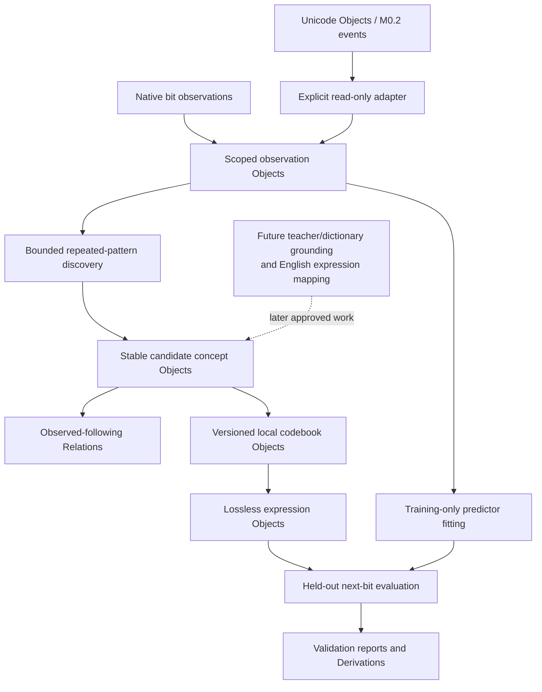
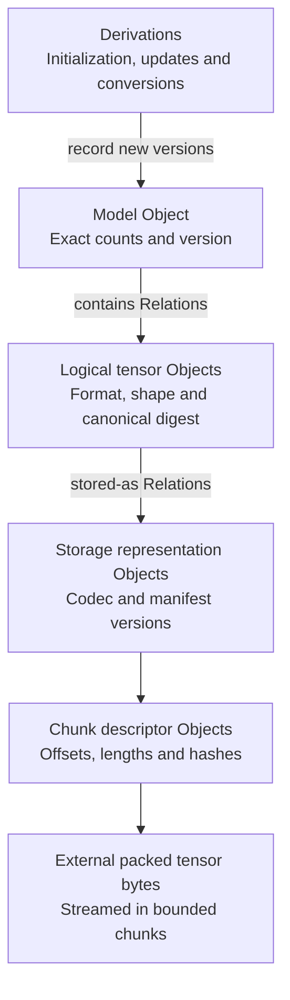

# M0.3 binary internal-language foundation

Completed **30 October 2026** under the user's direct instruction to read [the shared response](https://chatgpt.com/s/t_6ae44d42ba6481918fec6b463eb8ccf5) and implement it as foundational. The public page exposed one assistant response; its six architecture stages were recovered from inert visual markup. Earlier private messages were not available. The [source review](../manifests/binary-language-source-review.json) records hashes and extraction boundaries.

The adopted foundation separates physical bit encoding, internal representations and grounded meaning. Internal patterns need no English labels. Unicode remains an input format and the existing scalar collection is preserved. Stable conceptual identities are distinct from short local codes. Exact reconstruction is mandatory, and representation cost includes mapping overhead. The response's example English concepts and example binary labels were not imported as learner knowledge.

This build implements a bounded executable pipeline corresponding to the six stages. The concept, relationship and reasoning stages are partial prototypes: exact-pattern candidates, statistical adjacency and next-bit prediction respectively. Completion of M0.3 means this baseline passed its checks; it does not mean the shared response's full research architecture is implemented.

## Six architecture stages and their implemented baselines

| Stage | Executable baseline | Limit |
|---|---|---|
| Binary observation | Packed bits with explicit length, scope, source, root evidence identity, origin and train/holdout role | Input is supplied explicitly or generated by a declared engineering environment |
| Pattern discovery | Repeated contiguous substrings, 2–16 bits long, ranked deterministically within one scope | Frequency and overlap counts are observations, not meaning or causation |
| Concept formation | Immutable scoped pattern Objects, evidence Objects and support Relations | Candidates mean only exact bit-pattern occurrence under the declared scope |
| Relationship discovery | Directed observed-following Relations between tokens inside an observation | Includes literal fallback symbols; no inferred causal relationship or cross-event adjacency |
| Binary-language optimization | Finite dictionary-size search, deterministic Huffman prefix codes and raw fallback | Chooses among bounded candidates, not all possible languages or programs |
| Reasoning and validation | Frozen frequency-based next-bit predictions, majority baseline, exact reconstruction and full record replay | One-step statistical prediction with an observed prefix; no general inference or expertise claim |

## Source alignment and remaining concept-learning work

**Updated 30 October 2026 at the user's request.** A fresh fetch of the shared page yielded the same plain response and visual-markup content hashes as the original review. No additional public conversation turns or changed requirements were found. The [refresh receipt](../manifests/m0-3-source-refresh.json) records this comparison and current regression/dependency checks. This update refines the architecture and completion boundaries; it does not replace the canonical runtime profile or rewrite existing experiments.

The research objective is to discover reusable distinctions and operations that improve explanation, prediction and reconstruction of observations under measured resource constraints. Compact codes serve that objective. A recurring bit substring is an initial representational candidate; a grounded concept additionally needs an explicit connection to observations, actions, teacher foundations or identified lexical assertions, with task evidence for its use. Pattern IDs must not silently acquire new meanings: record any later semantic interpretation as a separate versioned Object linked to its supporting records.

| Source requirement | Present evidence | Remaining work and roadmap dependency |
|---|---|---|
| Observations and interaction before English labels | Native bit input and read-only import of one M0.2 history | A bounded environment interface with explicit action/outcome records; attach to M2's resumable harness and later M4 experiments |
| Discover useful concepts and reusable operations | Repeated-pattern candidates with independent-root support | Grounded behavioral distinctions, typed executable candidate rules and transfer to unseen situations; M2 foundations, M3 rule interpreter and M4 validation |
| Relationships, transformations and possible causes | Within-observation token adjacency | Distinguish association from tested transformation and causal hypothesis; require interventions or declared external support before causal acceptance at M4 |
| Optimize size, computation, error and access cost | Training-only weighted selection; exact reconstruction; partial encode/decode work proxies | Measure retrieval and complete execution costs; use independently defined semantic tasks once available. Unknown semantic error remains unknown, never zero |
| Predict, experiment, evaluate and revise | Frozen one-step prediction, replay and finite representation search | A bounded propose/test/revise loop with held-out checks, retained prior capabilities and explicit promotion/rollback; M4/M6 |
| Preserve accumulated knowledge when encodings change | Immutable scoped IDs and versioned codebooks with decoding checks | Version learned rules and semantic interpretations; evaluate any semantic revision separately from lossless code changes |
| Map human language onto internal representations | Unicode atoms exist independently of the native binary path | M1 ordered text sequences, then explicit form-to-concept/sense bindings at M2/M1L; a spelling does not create a meaning |

Entity, property, action, event and uncertainty in the shared illustration are possible domain Object types or relation meanings. They do not add primitive families or an automatically accepted vocabulary. Persistent representation remains exactly **Object, Relation, Derivation**. The core format and executable validation rules are engineering contracts. Future learned procedures can be versioned candidates inside a bounded interpreter; they cannot rewrite that interpreter or acceptance rules merely by emitting new bytes.

The native binary path remains independently usable. [M1.2](UNICODE_SEQUENCES.md) now provides a reversible text interface; it is not a prerequisite for every concept or nontext Object. Its deterministic scalar tokenizer and ordered composition advance the first-word roadmap without deciding a learned vocabulary or making text the only source of experience. The broader concept-learning work above retains its own build gates.

The accepted numeric/tensor scaling design below preserves the same distinction: logical content has stable identity, and physical codes or chunking can change through explicit representations. Numerical execution, bulk streaming and a large model remain later implementation work.



## Exactly three primitives and immutable identity

Every persistent record uses the pinned Scratch V1/SHA256 codec: **Object, Relation or Derivation**. Scope, source, observation, training snapshot, candidate concept, evidence, codebook, expression, predictor, prediction, run, report, declaration and operation are Object types. The registry and relation-type declarations are Objects too. The finite profile `sovereign-binary-language-v1` resolves every Object's type/definition/schema handles to declaration Objects.

The new registry profile uses the same canonical core format without changing M0.1, M1.1 or M0.2 identities. Its finite declarations are engineering bootstrap contracts, not learned linguistic definitions. It can run without importing the Unicode adapter, an OpenAI client or a pretrained model.

A pattern concept's payload is its scope Object ID plus an exact length-prefixed bit pattern. Changing its scope or pattern changes its identity. Evidence updates and training snapshots are separate Objects. A codebook contains a scope, training snapshot and explicit mappings from immutable concept IDs/patterns to prefix codes. Changing code assignments creates a new codebook Object; it never renames the concepts. Expressions name the exact codebook used, so an old expression remains decodable after later codebooks are created.

Two literal pattern Objects for `0` and `1` provide total input coverage. They are engineered fallback units; discovered multi-bit patterns are reported separately. Schema names and JSON report fields are engineering metadata. Observations, concepts, codebooks, expressions, predictors and predictions use binary payloads rather than English definitions.

## Binary wire contracts

All integers are unsigned big-endian. IDs are 32 bytes. A bit field is `u32 bit_count` followed by `ceil(bit_count/8)` bytes; unused low bits in the last byte must be zero. Empty bit strings are supported. Readers reject incomplete input, trailing bytes, nonzero padding, invalid tags and excessive lengths.

| Object payload | Canonical binary layout |
|---|---|
| Scope | Opaque UTF-8 engineering scope label; no lexical interpretation |
| Observation | scope ID, source ID, root ID, origin ID, split byte (0 training / 1 holdout), bit field |
| Training snapshot | scope ID, u16 observation count, ordered observation IDs |
| Concept | scope ID, bit field limited to 16 bits |
| Codebook | scope ID, training snapshot ID, u16 entry count; sorted entries of concept ID, pattern bit field, code bit field |
| Raw expression | scope ID, observation ID, tag 0, bit field |
| Prefix expression | scope ID, observation ID, tag 1, codebook ID, u32 original bit count, u32 token count, encoded bit field |
| Predictor | scope ID, training snapshot ID, two u32 global next-bit counts, u16 context count; entries sorted by bit pattern, containing concept ID and two u32 next-bit counts |
| Prediction | observation ID, predictor ID, predicted-next-bit field |

Declaration, registry, source, evidence, run, operation, relation-type and report payloads use canonical JSON as engineering metadata. Core Relation endpoints are Object IDs. An observed-following Relation carries the training snapshot ID and a u32 count in its context. Root and origin fields are explicitly provenance identifiers; an active adapter's source descriptor identifies the external source snapshot/instance. They are not silently treated as locally stored Object endpoints.

## Discovery, fitting and evidence

Repeated-substring support requires at least two distinct evidence roots by default. Multiple deliveries of one root count once. Conflicting bit content for a root is rejected. If duplicate deliveries have equal bits and different origin IDs, the first supplied delivery is retained; order is an explicit input property, and alternate deliveries remain in the upstream history. Overlapping occurrences are counted and labeled as such. These counts rank candidate patterns; compression is subsequently measured using actual non-overlapping tokenization and stored bytes.

Only the top bounded candidate set is materialized. The report's `candidate_concepts` is the count of those materialized multi-bit pattern candidates, not a count of every supported substring considered. Segmentation chooses the longest matching candidate, with a deterministic tie order. Candidate dictionary sizes are 0, up to 4, up to 8 and the configured maximum, plus a raw representation. Huffman construction uses a minimum weight of one for each dictionary symbol to keep unused fallback codes available. It is a baseline informed by [Huffman's original construction](https://compression.ru/download/articles/huff/huffman_1952_minimum-redundancy-codes.pdf), not a claim of universal representation optimality.

Fit, code assignment, predictor counts and representation selection use training observations only. Training and holdout roots must be disjoint. The predictor uses the longest supported suffix context and a global majority fallback; ties select zero. Held-out evaluation predicts each next bit using the preceding observed bits, without updating the model. It is not an autonomous rollout. The majority baseline uses the same training observations and held-out target positions.

No edge connects the end of one observation to the beginning of another. All concept, codebook and expression references are scope-specific. An adapter reads only one selected M0.2 instance, retaining forwarded observations' original root IDs. It does not pool group/member histories or write back to the active store. The adapter verifies the source store when importing; later self-contained replay verifies the captured records and derivation, not the external world's truth.

## Objective and accounting

The finite selector minimizes `w_bits B + w_encode C + w_errors E + w_decode D` on training data. Weights are explicit nonnegative integers; `w_bits` must be positive. Default weights are `(1, 0, 0, 0)`, so the initial experiment selects by representation size while reporting the other measurements.

- **B:** bits for the incremental representation package: full concept/codebook records where needed, expression records, canonical IDs, framing, collection header and byte padding. Raw storage needs only its expression records under the fixed shared profile.
- **C:** an engineering work proxy consisting of segmentation comparisons, emitted bit visits and predictor context checks. It excludes some bookkeeping, frequency-table and Huffman construction overhead; it is not measured CPU time or complete instruction count.
- **E:** training next-bit error count. Held-out error is reported separately and cannot influence selection. Semantic error is unknown and recorded as null, not zero.
- **D:** a decoding work proxy: encoded bit visits plus codebook-entry count, or raw bit visits. It does not measure every parsing, allocation, lookup or reconstruction operation.

This package boundary assumes the same fixed schema/profile and provenance context for all candidates. It excludes common source observations, declarations/scope metadata, predictor/report records and the retained search audit. **The audit collection keeps all observations and candidates and can be much larger than a selected representation.** The system does not claim that the complete project database shrank. Standalone holdout sizes charge the selected dictionary once to the smaller holdout batch; they can exceed raw storage even when training selection favored a dictionary.

Exact reconstruction is a hard constraint, not a tradeable penalty. The accounting follows the model-plus-data motivation of [Minimum Description Length](https://homepages.cwi.nl/~pdg/ftp/mdlintro.pdf), but this heuristic substring search is not a general MDL solver. Different weights can deliberately select lower work over fewer stored bits. A regression test checks that tradeoff.

## Bounds and persistence

At most 128 supplied observations per split, 4,096 bits per observation and 65,536 bits total are accepted. There are at most 32 discovered patterns, each at most 16 bits, plus the two literals. Those limits bound discovery to fewer than 983,040 substring visits before pruning and bound the finite segmentation/prediction searches. Prefix words have at most 64 bits; decoded output length and token count are checked before allowing expansion. Up to 8,192 canonical records and 16 MiB per artifact collection are accepted, in addition to existing per-record/reference limits.

The physical collection starts with `SOVBIN1\n` and a u32 record count. Frames, sorted by ID, contain a one-byte primitive family tag, 32-byte ID, u32 canonical length and canonical bytes. The physical container adds no primitive. Creation uses a staging directory and publishes only after verification; existing destinations are rejected.

Verification checks file hashes, canonical framing, identities, declarations, primitive references and then re-executes the complete run from its recorded observations/configuration. Every rebuilt record byte and the report must match. Well-formed but unexecuted records fail replay. Code implementation hashes are provenance pins in the manifest; artifact identity/replay is separate from the local source file's current formatting or version.

## Saved results

The [demonstration guide](../data/experiments/binary-language/m0-3/README.md) links both artifacts.

| Measurement | Native periodic-bit environment | M0.2 atom-A adapter |
|---|---:|---:|
| Training / holdout observations | 12 / 4 | 3 / 1 |
| Selected encoding | Four-pattern prefix dictionary | Raw |
| Training representation / raw baseline, bits | 39,880 / 44,928 | 5,256 / 5,256 |
| Standalone holdout representation / raw, bits | 21,800 / 15,072 | 1,816 / 1,816 |
| Held-out next-bit errors / majority errors | 2,049 / 4,098 over 8,197 targets | 2 / 2 over 31 targets |
| Objects / Relations / Derivations | 194 / 46 / 6 | 131 / 37 / 6 |
| Full audit collection bytes | 116,618 | 71,790 |

The native fixture is a declared deterministic periodic environment, not a natural-language dataset or an independent demonstration of general intelligence. Its dictionary helps the larger training package but costs more for the smaller holdout package. The active adapter demonstrates scope/provenance and raw fallback; it shows no prediction improvement over the majority baseline. All reported reconstructions are exact, including non-byte-aligned held-out observations.

The [verification receipt](../manifests/m0-3-verification.json) records checks and hashes. The suite has 36 new binary-foundation tests plus 67 existing tests, all passing. Tests include generated bit-string round trips, malformed codecs, dictionary changes, source-scope isolation, deduplication, holdout leakage, work/size tradeoffs, immutable artifact replay and an independent rebuild. One bounded OpenAI development review used 7,075 tokens; its suggestions were checked against local code/tests and informed documentation of accounting limits and duplicate-origin retention. It supplies neither learner observations nor grading authority.

## Commands and next interfaces

From the project root:

```sh
uv run --locked python -m tools.binary_language verify
uv run --locked python -m tools.binary_language inspect
uv run --locked python -m tools.binary_language verify \
  --directory data/experiments/binary-language/m0-3/active-atom-a
```

To produce a fresh immutable snapshot:

```sh
uv run --locked python -m tools.binary_language demo --directory .cache/new-binary-demo
uv run --locked python -m tools.binary_language from-active --instance atom-a \
  --directory .cache/new-atom-a-binary
```

`build --input /absolute/path/input.json --directory /new/destination` accepts exactly `scope`, `training`, `holdout`, `source` and `config`. Each observation has `bits`, `root` and `origin`, with provenance IDs as lowercase 64-character hex strings. `source` has `kind` (`raw-bits`, `engineering` or `active-objects`) and a `reference` string. The config fields and default weights are in `DEFAULT_CONFIG` in [the implementation](../tools/binary_language.py). `inspect --id ACTUAL_ID` displays an exact record, primitive kind, payload and declaration references. These are engineering tools, not an English instruction parser.

All M0.3 demonstrations and fixtures are marked `learner_ingestion_allowed: false`. They are development experiments. Future teacher-approved ingestion must enforce source eligibility rather than infer authority from text labels. The shared chat's architectural guidance is not teacher data.

Later work can bind grounded meanings and English expressions to these stable representations, test richer executable abstractions, and evaluate independently observed tasks. Information bottleneck, vector quantization, hierarchical reinforcement learning, general program synthesis, learned graph representations, emergent communication and arithmetic coding remain research options. They were not installed or presented as completed. Future neural frontends must bind embeddings to stable concept identities or explicit versioned vocabularies, not reinterpret changing local prefix codes as stable token IDs.

## Accepted scaling design: numeric values, tensors and bulk storage

**Accepted by the user on 30 October 2026 as the fundamental scaling direction for later M0.3 improvements. Status: architecture adopted; numeric/tensor schemas, streaming storage and numerical execution are future approved builds.** The current codec limits and completed M0.3 artifacts remain the implementation baseline. The trillion-parameter example is a capacity-planning case, not an implemented capability or a model-size commitment.

### Numeric definitions and exact counts

Parameter counts, dimensions, indices, byte lengths and offsets use exact integer schemas. The initial scaling design uses unsigned 64-bit fields with checked arithmetic; shape products, offset/length additions and byte-count calculations must reject overflow. A later arbitrary-precision profile would require an explicit schema version. FP32 describes a parameter's value representation, not the parameter count.

The integer `1,000,000,000,000` needs a 40-bit value payload and fits in uint64. One trillion FP32 values require `1,000,000,000,000 × 4 = 4,000,000,000,000` bytes before metadata, execution or training state. Exact model counts must define how shared/tied parameter storage is counted. These are distinct contracts: describing a count, preserving numeric values and executing operations over those values.

A numeric schema declares integer signedness/width or floating-point format, canonical byte order and validation. Numerical operations additionally declare rounding, special-value handling and applicable reproducibility limits. Lossless storage preserves the original canonical bit patterns, including signed zero and NaN payloads where supported by the chosen profile; an operation that intentionally changes them records a conversion. Implementing numeric infrastructure does not teach the learner mathematics or change the English-first curriculum.

### Tensor and storage representation

Pack parameter values into tensors and chunks. Model, tensor, storage-representation and chunk descriptors are typed Objects, each with the ordinary identity/type/definition/schema/payload contract. Relations connect those Objects, and Derivations record initialization, updates, conversions, encoding and checkpoint publication. Bulk bytes are physical artifacts referenced and verified by these records, not a fourth semantic primitive.

| Descriptor | Required design information |
|---|---|
| Model | Architecture/version, parameter-count policy and exact counts, tensor references, vocabulary/concept mapping version |
| Logical tensor | Numeric format, shape, declared layout, canonical byte order, exact logical byte length and digest of its canonical uncompressed byte image |
| Storage representation | Logical tensor ID, storage format/version, codec and codebook references where applicable, ordered chunk-manifest reference |
| Chunk | Logical offset and length, stored length, stored and decoded-content hashes, physical locator through the storage adapter |
| Checkpoint | Model/representation versions, optimizer and runtime state when needed, completed-manifest references and operation provenance |

Logical tensor identity is separate from physical chunking or encoding. A lossless recompression or rechunk creates a new storage-representation Object while preserving the logical tensor's metadata and canonical-content digest. The whole logical digest is computed incrementally; it does not require loading the complete tensor into memory. A weight update or lossy transformation changes the logical content and produces a new tensor/model version. Numeric replay tolerances never authorize changing the canonical bytes beneath an existing ID.

A parameter can be addressed by a tensor identity and validated index/offset when individual inspection is needed. Normal model storage uses packed arrays rather than one full graph record per weight. Graph storage holds descriptors, relationships and provenance; bulk files/object storage hold tensor bytes. Neo4j remains the initial planned graph backend, with Spanner conditional on later workload evidence.



### Scaling and preservation rules

Reads, writes, validation and decompression operate with declared chunk/memory budgets. Large manifests use bounded hierarchical pages rather than overflowing the core's reference limits. The initial dense-tensor profile must verify chunk order, coverage, length, non-overlap and hashes; sparse or specialized layouts require their own explicit contracts. A completed checkpoint becomes visible only after its referenced data/manifests are complete and verified. Restart must distinguish staged work from committed artifacts.

Lossless codecs must reconstruct the exact canonical tensor image and retain all codebook dependencies. Quantization, lower precision and other approximate transforms are separately versioned operations with error and task-quality/retention measurements before promotion. No compression ratio, giant-model execution capability or reduction in compute is implied by a shorter identifier or a metadata declaration. Cost reports include dictionary/manifest overhead, actual stored bytes, peak memory, decode/encode work and I/O measurements relevant to the experiment.

The existing 4,096-bit observation, 65,536-bit experiment and 16 MiB artifact limits remain unchanged. Later builds introduce storage/streaming interfaces and their own measured limits; they do not scale by treating a multi-terabyte model as one current observation or one canonical Object payload.

### Roadmap attachment and acceptance evidence

| Roadmap point | Later extension | Required evidence before completion |
|---|---|---|
| Remaining M0 contracts | Exact integer/numeric-format definitions, tensor/representation schemas and operation contracts | Boundary/overflow checks, format fixtures, declared special-value behavior and stable identities |
| M1 durable-storage extensions | Local chunk/blob adapter, manifests, streaming verification and graph references | Exact reconstruction, bounded memory, missing/corrupt chunk detection and interruption recovery |
| First approved neural experiment | Connect a small random-initialized model to tensor/checkpoint descriptors | Correct shape/dtype/byte counts, checkpoint reload and measured execution; stable vocabulary mapping |
| M6 lifecycle | Versioned updates, optimizer/runtime state, checkpoint promotion/rollback and optional lossy experiments | Resume/rollback correctness plus independent quality and retention checks |
| M9 scale | Workload-driven partitioning, placement and optional Spanner integration | Measured throughput, latency, I/O, memory, cost and recovery; no scale claim from metadata alone |

These extensions follow roadmap dependencies and the per-build approval process. Representation tests can use small tensors and large integer metadata to verify contracts; claims about storing or executing large models require separate end-to-end workload evidence. The confirmed requirement and decisions are R26/D34–D35 in [DECISIONS.md](DECISIONS.md).
