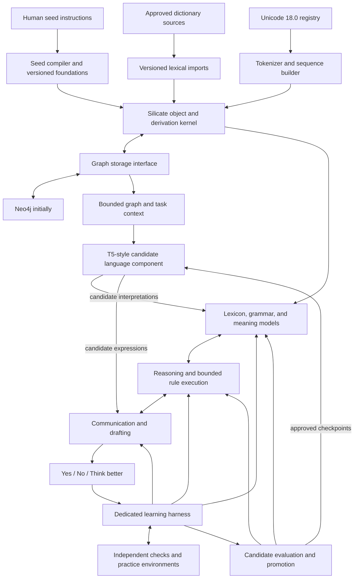

# SovereignAI design and implementation plan

Version 0.3 — 30 October 2026 — Twelve mathematical directions mapped to components and gated experiments

**Purpose.** Build an original learning system whose foundation is Silicate's Object, Relation, and Derivation primitives with native binary observations and scoped internal concepts. Unicode 18.0 remains the first symbolic input collection. The system begins with opaque observations, receives foundational instruction from its human teacher, develops English competence, and later uses English to acquire mathematics and other subjects. Language, clarity, judgment, logic, reasoning, and communication remain active learning tracks throughout its life.

**Status.** This document specifies a research and engineering program. Algorithms, performance thresholds, component boundaries, and schedules below are proposed designs. No performance or expertise claim has been demonstrated. The repository was empty before these planning documents were added. The [decision register](DECISIONS.md) records the requirements and unresolved choices; [data and learning contracts](CONTRACTS.md) make the initial interfaces concrete; [source notes](SOURCES.md) distinguish verified infrastructure facts from design proposals.

**Build control.** The user requires approval before each new build. Present the roadmap connection, goal, scope, dependencies/API use and completion checks, then wait unless the current direct implementation instruction already authorizes that concrete build. The [build workflow](BUILD_WORKFLOW.md) and [ledger](BUILD_LEDGER.md) record authorization. M0.1, M1.1, M0.2, M0.3 and M1.2 are complete as bounded slices; further expansion needs authorization.

**Foundational update, M0.3:** the user's [binary-language design](BINARY_FOUNDATION.md) is implemented as a six-stage baseline: binary observations, scoped pattern candidates, concept/evidence Objects, association Relations, versioned prefix-code representations and reconstruction/prediction validation. Internal representations do not need English labels. This preserves the Unicode collection, active-object scopes and English-first subject curriculum. Short encoding aliases cannot redefine canonical concept identity. Bit-pattern prediction is not a demonstration of English comprehension or mathematics mastery.

**Accepted scaling direction:** future M0.3 improvements use exact integer counts/offsets, explicit numeric formats, logical tensor Objects, versioned storage/chunk descriptors and external packed bytes accessed through bounded streaming. Logical identity survives lossless representation changes; weight updates or lossy transforms produce new versions. This is the user-adopted [scaling design](BINARY_FOUNDATION.md#accepted-scaling-design-numeric-values-tensors-and-bulk-storage), not an implemented numeric engine or large-model capability. Its delivery follows the roadmap attachments below.

## 1. Product contract and learning boundary

The human provides foundational concepts and instructions for each subject and does not have to supply training datasets. After foundations are supplied, human assessment uses only **Yes**, **No**, or **Think better**. The user has also approved open dictionaries as explicitly identified foundation data. Begin with Open English WordNet and add selected Wiktionary information through a versioned import layer. The running system uses no pretrained LLM or pretrained embedding model. Other external corpora are outside the current scope. No resource is used as a hidden source of knowledge. See section 23 and [the lexical foundation design](LEXICAL_RESOURCES.md).

The user separately authorized OpenAI for development assistance only. Its helper can propose engineering changes, reviews, debugging advice and test plans. External output remains ineligible for learner data, live learner responses, authoritative assessment or promotion evidence. Inspect generated code/fixtures for hidden linguistic knowledge and audit answers. See [DEVELOPMENT_ASSISTANCE.md](DEVELOPMENT_ASSISTANCE.md).

The system can generate exercises, candidate expressions, simulated situations, attempted proofs, alternative explanations, and revisions. Those attempts become experience. A generated answer is not its own evidence of correctness: assessment must come from a seed-derived independent verifier, an observed environment outcome, a checked derivation, or human feedback.

Unicode defines the symbolic substrate. It does not supply English word meanings, conventions, facts, or judgment. Your seed instructions, assessments, and approved lexical foundations supply semantic and evaluative information. Importing a dictionary supplies external data even when the engine performs no neural-network training; that origin remains visible in experiments. Computational machinery—comparison, sequencing, storage, execution, search, and resource accounting—must be engineered explicitly.

The initial English target is a declared, progressively expanding range of tasks. Expert communication is a long-term target supported by assessments across those tasks. There is no justified promise that a small set of seeds and unlimited self-practice will produce unrestricted expert English. When the system lacks a meaning, convention, fact, or evaluative signal, it must retain that uncertainty.

The learning trajectory is:

```text
Unicode scalar objects
  → ordered sequences
  → grounded vocabulary and word boundaries
  → morphology, grammar, and compositional meanings
  → English comprehension and instruction following
  → reasoning, communication, drafting, critique, and revision
  → English readiness and expert-performance assessment
  → mathematics foundations taught through supported English
  → further subjects, with continued growth in every capability
```

Capability growth is expected to be uneven. Candidate changes can improve one skill and damage another; retention tests and reversible promotions are part of learning, not optional maintenance.

## 2. The three primitives and the computational kernel

Use **Object, Relation, and Derivation** as the three persistent semantic primitives. A word, concept, grammar rule, assessment, or curriculum item is a type of Object; it does not require a fourth primitive.

| Primitive | Responsibility | Examples |
|---|---|---|
| Object | A typed, schema-bound payload with a reproducible identity | Unicode atom, sequence, concept, rule, hypothesis, draft, feedback record |
| Relation | A directed, typed connection with explicit order/context where needed | Ordered component, denotes, depends on, supersedes, supports, contradicts |
| Derivation | A record of an operation, its rule/version, inputs, parameters, and outputs | Compose a sequence, parse a sentence, apply a rule, produce a revision |

The inspected SilicateScratch core represents these structures, including ordered Relations and Derivations that can name both Object and Relation inputs. The RustSilicate and SilicateScratch variants have different layouts. M0.1 selected the Scratch V1/SHA256 format at a pinned revision and file hashes and verified independent compatibility fixtures. See [FOUNDATION_CONTRACT.md](FOUNDATION_CONTRACT.md). Upstream source vendoring/license clearance and production-kernel integration remain unresolved; valid format compatibility does not imply complete core integration.

There are exactly three core primitives. Every later persistent Object uses explicit identity, type, definition, schema and payload. Type/definition/schema declarations are themselves Objects, resolved through a finite versioned bootstrap registry. M1.1 implements the first such registry for engineering declarations and Unicode scalar atoms.

**Proposed implementation direction:** retain a small Rust kernel for canonical records, identities, strict decoding, and structural verification; develop the new learning system above it. Initially use a Python harness and the official Neo4j Python driver to make experiments and storage transactions straightforward. Connect the kernel through a versioned, persistent local worker protocol that accepts batches. Avoid spawning a process for each symbol. A later direct language binding is an optimization, conditional on profiling.

**Environment established:** CPython 3.11.18 is installed locally, with exact library pins and a complete uv lockfile. See [ENVIRONMENT.md](ENVIRONMENT.md) for activation, reproduction, library purposes, and validation. This prepares the Python side of the proposed stack; it does not implement the harness or Rust integration.

**Neural architecture direction:** the T5/BART comparison selects a small, randomly initialized T5-style encoder–decoder as the first neural experiment. It extends the symbolic plan with candidate language generation and interpretation while preserving explicit reasoning, graph provenance, and independent evaluation. It uses the project's Unicode interface rather than a pretrained vocabulary. The symbolic implementation remains the baseline; this component becomes a dependency only after measured benefit. See [MODEL_CHOICE.md](MODEL_CHOICE.md) for the rationale, scope, training-data requirements, and comparison protocol.

**Mathematical extensions:** all twelve directions from the user's later shared response are mapped in [MATHEMATICAL_EXTENSIONS.md](MATHEMATICAL_EXTENSIONS.md), with identifiers AX01–AX12 and a [draft experiment register](../experiments/mathematical_extensions.toml). They are optional implementations or strengthened contracts inside these components, not additional persistent primitives. Exact graph records remain authoritative; numerical views are derived, versioned, and independently evaluated. Section 24 summarizes the integration.

This is a new cognitive implementation using a small existing representational foundation. Standard cryptography, database drivers, and Unicode reference data remain infrastructure dependencies. The source of learned linguistic knowledge remains explicit.

**Engineered kernel operations:** identity comparison, ordered composition/decomposition, schema checking, variable binding, pattern matching, bounded rule application, conditional selection, and bounded search. Operations have executable implementations and stable identifiers. Merely naming an operation in a graph does not implement it. New learned programs combine permitted operations in a restricted rule language; they do not execute arbitrary host code.

**Five distinct verification levels:**

1. **Identity:** canonical bytes match the claimed ID.
2. **Structure:** the schema, references, types, cardinalities, and ordering are valid.
3. **Execution:** replaying an approved deterministic operation reproduces its outputs.
4. **Domain validity:** the result satisfies the relevant English, logic, or later mathematics criteria.
5. **Empirical support:** observed outcomes or human assessments support the claim in its stated context.

A valid hash establishes level 1 only. A derivation receipt does not by itself establish truth, understanding, or correct execution.

## 3. Unicode 18.0 and the initial tokenizer

Pin official **Unicode 18.0.0** data and the corresponding applicable specifications. The official release announcement and UCD ReadMe confirm the final release. Keep source URLs, license information, downloaded file hashes, importer version, and an import manifest. Do not use a moving `latest` URL as the reproducibility anchor. [Unicode release](https://blog.unicode.org/2026/09/announcing-unicode-standard-version-180.html), [UCD ReadMe](https://www.unicode.org/Public/18.0.0/ucd/ReadMe.txt).

**Available locally:** the official UCD and Unihan archives and all 79 extracted data files are saved under [data/unicode/18.0.0](../data/unicode/18.0.0/README.md), with source URLs, license, version checks, and SHA-256 records. This completes source acquisition for those two archives. It does not complete the symbol importer, tokenizer, standards conformance implementation, or graph population in milestone M1.

**M1.1 completed:** the initial importer has materialized 310,341 assigned Unicode scalar Objects plus six engineering declaration Objects in [data/objects/unicode/18.0.0](../data/objects/unicode/18.0.0/README.md). Canonical bytes are stored in `objects.bin`; `index.sqlite` provides local lookup and infrastructure metadata; `registry.json` resolves declarations; the manifest records coverage/hashes/reproduction. Source ranges are expanded and 2,048 surrogates excluded. Sequence tokenization, Unicode normalization/segmentation conformance and the Neo4j adapter remain later work.

**Initial atomic identity:** a Unicode scalar value, associated with the pinned repertoire/profile. A scalar is the unit exposed to the early learner. UTF-8 bytes and UTF-16 code units are transport representations; rendered glyphs and user-perceived characters are separate layers.

The input pipeline is:

```text
Raw input bytes
  → strict UTF-8 decoding
  → original scalar sequence and byte/scalar span map
  → symbol registry lookup
  → ordered sequence Object
  → optional grapheme view
  → candidate lexical segmentations
```

The first tokenizer is deterministic and requires no trained vocabulary. It produces scalar tokens with stable symbol references. Later segmentation can recognize words, morphemes, phrases, and sentences. It always retains the mapping to original scalars. Whitespace and punctuation initially remain symbols; their linguistic roles come from the English foundations.

**Required Unicode policies:**

- Preserve the original scalar sequence. Do not silently case-fold, strip characters, merge visually similar symbols, or normalize evidence.
- Offer normalization as an explicitly versioned derived view. Do not equate normalized text identity with original sequence identity. Use the pinned normalization rules and conformance tests. [UAX #15](https://www.unicode.org/reports/tr15/tr15-58.html).
- Treat grapheme segmentation as a separate standards-based view. Combining sequences and emoji sequences can contain several scalars. A grapheme boundary is not a learned word boundary. [UAX #29](https://www.unicode.org/reports/tr29/tr29-49.html).
- Reject malformed UTF-8 and surrogate values at the scalar interface. Record import errors with byte offsets; do not silently replace them with another symbol.
- Declare how unassigned values, private-use values, noncharacters, controls, variation selectors, and bidirectional controls are accepted, flagged, or excluded from an exercise alphabet. Preserve valid raw evidence even when an exercise disallows a symbol.
- Display invisible/control characters using escaped forms in inspection views. A missing font glyph does not make a stored symbol invalid.
- Keep Unicode character names, categories, numeric properties, and case mappings in an infrastructure view. Do not expose them as learned meanings. For example, the Unicode numeric property of `1` must not silently teach the mathematics curriculum.
- Treat code-point numbers and hashes as identities, not semantic distances or magnitudes.
- Support the full pinned repertoire while materializing graph atoms lazily or in import batches. A large alphabet does not justify searching all possible strings.

The macOS system Python was observed to use Unicode 13.0.0; the new project Python 3.11.18 environment uses Unicode 14.0.0 in its built-in `unicodedata` module. Neither built-in database is an authority for Unicode 18.0. Use the pinned source files and a conformance-tested implementation for version-sensitive operations. The same version check applies to any chosen runtime or library. Existing Silicate Unicode documentation also does not establish complete Unicode 18.0 coverage; the new import must verify it directly.

**Only textual fields are tokenized.** Concepts, rules, observations, and derivations retain structured references. Do not flatten the entire cognitive graph into a token stream just to process it.

## 4. How symbol objects become words

Initially, `c`, `a`, and `t` are distinguishable objects without English meaning. Their ordered composition is a sequence object. A teacher foundation or approved dictionary can establish a lexical entry and a claimed sense. Grounding and competent use require separate teaching or assessment; storing an imported entry does not establish understanding.

```text
Atom c ──ordered component, position 0──→ Sequence cat
Atom a ──ordered component, position 1──→ Sequence cat
Atom t ──ordered component, position 2──→ Sequence cat

Lexical entry ──has written form──→ Sequence cat
Lexical entry ──denotes, in context──→ Concept supplied by teacher
Seed assertion ──supports──→ Lexical binding assertion
Derivation: compose([c,a,t], sequence-rule) → Sequence cat
```

The displayed names are labels for the human inspector. A label does not confer a concept on the learner. A simulated entity used as an initial referent is a local grounding aid; it does not teach everything about real cats.

Keep **written form**, **lexical entry**, **sense**, and **referent** distinct. One spelling can have multiple senses; several forms can refer to the same concept. Inflectional forms and context-sensitive uses need their own evidence.

Repeated symbols must preserve their occurrences and positions. In `letter`, the two occurrences of `t` can reference the same atom but require distinct ordered positions. In a sentence containing a repeated word, word identity must not collapse token occurrences or their grammatical roles.

Bootstrap word boundaries from the teacher's structured seed entries. Once sufficient vocabulary exists, learn alternative segmentation and morphology from generated practice and feedback. Maintain several candidate segmentations when needed. Do not silently select the first parse.

A new string is not automatically an English word. Mark an unsupported form as a candidate or locally coined term until the relevant teacher or seed-based checks establish its use.

## 5. Foundation teaching before the system knows English

The bootstrap interface must not require the learner to understand unrestricted English in order to learn English. The human-facing interface may use English labels, but it compiles explicit fields and bindings into machine-readable seed objects.

Each seed bundle contains:

| Field | Meaning |
|---|---|
| Subject and bundle version | English first; mathematics and further subjects later |
| Concept identifiers | Stable references independent of their English spellings |
| Written forms | Exact Unicode sequences and declared lexical senses |
| Concept grounding | A scene referent, operation, relation, property, or logical contract |
| Foundational instructions | Explicit constraints and composition rules |
| Preconditions and scope | Where a rule applies and which meanings it assumes |
| Assessment criteria | The specific properties that make an attempt acceptable |
| Dependencies and provenance | Which earlier seeds are required and who supplied this seed |
| Unresolved points | Ambiguities that the compiler cannot resolve safely |

A seed may be entered through a form, a small declarative notation, or a deliberately restricted instruction language. Initially, translating free prose into this notation is an engineering/teacher task; it is not claimed as an ability of the untrained learner. Later, the learned English parser can propose seed interpretations and request Yes/No confirmation before those interpretations become accepted foundations.

Seed bundles are immutable and versioned. Corrections create new versions and trigger reevaluation of dependent claims. The learner may propose a change but cannot silently redefine the teacher's foundations, the evaluator, or the meaning of Yes/No/Think better.

English seeds must eventually supply lexical meanings and conventions such as roles, agreement, order, negation, reference, and discourse purpose. Some may be direct rules and others may be learned through feedback. Track which is which. A rule explicitly given in a seed is **taught**, even if the learner later compiles it into an efficient procedure.

## 6. Architecture and component contracts

The diagram shows the planned architecture, including the subsequently selected T5 experiment. For a dated distinction between working artifacts, selected directions, and pending details, see [ARCHITECTURE_STATUS.md](ARCHITECTURE_STATUS.md).



| Component | Input → output | Key boundary |
|---|---|---|
| Kernel | Typed records → canonical records, IDs, verification | No domain inference from bytes |
| Unicode registry/tokenizer | Bytes → atoms, spans, sequence/segmentation candidates | Exact source reconstruction |
| Seed compiler | Explicit teaching fields → versioned foundation graph | Unknown prose is not silently interpreted |
| Lexical learner | Forms, meanings, approved source assertions, feedback → lexical hypotheses | Imported knowledge and demonstrated competence remain distinct |
| Grammar learner | Lexicon, seeds, attempts → versioned construction rules | Rules are data interpreted by code |
| Meaning interpreter | Parse and context → scoped semantic graph | Preserve alternatives and ambiguity |
| Reasoner | Meaning graph and evidence → conclusions, plans, questions | Record assumptions and support |
| Drafting engine | Task, audience, known content → draft and revision candidates | Do not invent missing facts |
| Harness | Run configuration → bounded, resumable learning episodes | Own budgets, checkpoints, and scheduling |
| Evaluator | Exact attempt and criterion → independent assessment | Hidden checks remain inaccessible to learner |
| Promotion manager | Candidate and evidence → accept/reject/defer | Preserve rollback and retention metrics |
| Graph adapter | Logical records/queries → backend transactions | No database dialect in learning algorithms |
| Graph/model context bridge | Task and authorized memory → bounded model context | Preserve references; exclude evaluator-only information |
| T5-style experiment | Tokenized context → candidate interpretations/expressions | Random initialization, custom vocabulary, independent validation; no direct accepted-state writes |

Start with a local command-line harness and a compact local teaching/assessment interface. A large application UI, distributed orchestration, and cloud deployment are later implementation choices.

## 7. Graphs, identity, and knowledge state

Use one logical record model with several query views:

| Graph view | Contents |
|---|---|
| Symbol/composition | Atoms, ordered sequences, spans, segmentation alternatives |
| Lexical/semantic | Written forms, senses, concepts, referents, context bindings |
| Grammar | Construction rules, grammatical features, parse forests, dependencies |
| Evidence/experience | Seed assertions, observations, tasks, attempts, assessments |
| Reasoning | Assumptions, inference steps, proofs, hypotheses, conflicts |
| Skill/curriculum | Procedures, objectives, prerequisites, practice opportunities |
| Capability/evaluation | Rubrics, benchmark versions, scores, regressions, promotions |

These are views over Object/Relation/Derivation records, not seven independent databases.

**Record identity:** canonicalize in the pinned Silicate format and hash in the appropriate domain. Preserve schema and rule versions. Do not hash incidental JSON key order. Use canonical fixed representations for numeric fields; do not let platform-dependent floating-point formatting change object IDs.

Immutable content identity must commit to the content that defines the object. A sequence payload must include its ordered child references or another complete canonical commitment. Appending an external Relation must not silently change the meaning of an immutable sequence under the same ID.

Use new objects for changed rules, beliefs, drafts, and capability snapshots. A mutable pointer may select the active version; it is an index, not the authoritative historical record. `SUPERSEDES` preserves lineage. Retiring a belief does not delete the observations that caused it.

**Epistemic status:** taught, source-asserted, observed, derived-under-assumptions, hypothesized, supported-in-context, contradicted, superseded, or unresolved. Keep these separate from structural validity. Knowledge origin and demonstrated competence are separate fields: an imported sense remains imported even after the system learns to use it correctly. Confidence belongs to a specified claim/context/model, not to an entire sentence or arbitrary graph node.

**Evidence dependence:** repeated reading or paraphrasing of one seed is one source. A learner-generated statement is not an independent witness. Keep root evidence identifiers so repeated derivations cannot multiply confidence without new information.

**Derived numerical views:** AX03 hyperdimensional signatures, AX10 sparse associative indexes, AX04 spectral projections, AX11 scoped sheaf diagnostics, and AX12 wavelet signals are potential read/analysis views of this same graph. They return exact record references, candidate rankings, or diagnostic reports. Source snapshot, sense/context filters, numerical profile, and artifact dependencies must be recorded. Similarity or agreement cannot promote a hypothesis into accepted knowledge, and a stale view cannot silently stand in for current state.

**Occurrence identity:** observations include a run/episode/event identity. Several independent events with identical content remain distinct occurrences, while identical word forms can deduplicate.

Rules and hypotheses can reference uncertain premises, but derived conclusions retain those conditions. Cyclic support must not manufacture evidence. A task may end with an unresolved answer when its premises or meanings are insufficient.

## 8. Neo4j, Spanner Graph, and persistence

**Initial decision: Neo4j as the authoritative persistent store.** It fits the local prototype and rapid inspection of changing graph models. Its official Docker deployment supports persistent volumes, and its Python driver supports grouped transactions. [Neo4j deployment](https://neo4j.com/docs/operations-manual/current/docker/introduction/), [transactions](https://neo4j.com/docs/python-manual/current/transactions/).

| Choice | Proposed use | Cost/complexity tradeoff |
|---|---|---|
| Neo4j alone | First implementation and research runs | One local authority, straightforward graph inspection |
| Spanner Graph alone | Later deployment needing managed distributed storage and transactional graph/tabular access | Cloud infrastructure and operational cost need measurement |
| Both | A measured need for separate authoritative storage and graph exploration/projection | Replication, lag, reconciliation, and duplicated operations |

Spanner Graph maps tables to property graphs and exposes GQL-compatible querying. The documented cloud feature uses GoogleSQL databases and Enterprise/Enterprise Plus editions. The adapter must account for its schema and query model; Cypher cannot simply be sent to it. [Spanner overview](https://docs.cloud.google.com/spanner/docs/graph/overview), [schema](https://docs.cloud.google.com/spanner/docs/graph/schema-overview).

**Physical Neo4j representation:**

- Store each Object, Relation, and Derivation as a first-class record node with kind, content ID, format version, and canonical payload encoding.
- Reify Relations as nodes so their own identity and use as derivation inputs remain representable. Maintain convenient direct semantic edges as rebuildable projections that name their source Relation ID.
- Store ordered `USES`/`PRODUCES` projections for Derivation inputs and outputs. Preserve record kind and ordinal position.
- Resolve DefinitionId, SchemaId, RuleId, and OperationId through an explicit registry. Do not cast them to ObjectId just because all are hashes.
- Enforce record-ID uniqueness, run-event uniqueness, and optimistic version checks. Parameterize queries. Return deterministic ordering where algorithm behavior depends on result order.
- Commit a completed learning step's new records, assessments, active-state update, and checkpoint reference atomically.

**Adapter contract:** `put_verified_batch`, `get_records`, `query_relations`, `find_derivations`, `load_snapshot`, `commit_step(expected_revision, batch)`, and `export_run`. Define capabilities and limits instead of assuming arbitrary identical queries across stores. Core tests use an in-memory adapter; real persistence uses Neo4j.

**Retry correctness:** produce record IDs and intended changes before a transaction callback. Database retries must not re-run a learning update, re-ask the teacher, or re-execute an environment action. Neo4j explicitly documents that managed transaction callbacks may be retried. Environment actions need their own idempotency keys and durable status; database atomicity does not imply exactly-once external effects.

Keep hot candidate evaluation in a bounded in-memory working set. Batch persistent reads/writes, cache immutable records by ID, and invalidate active-view caches when versions change. Avoid one remote database round trip per symbol or per search expansion.

If both databases become necessary, choose one authority. Publish committed record batches through a transactional outbox, apply them idempotently to the projection, record a replication watermark, and reconcile counts and hashes. Learning decisions must use an explicitly consistent snapshot. Do not create uncoordinated synchronous dual writes.

Benchmark storage with actual record sizes, fanout, derivation depth, and write patterns before migrating. Spanner's emulator is useful for compatibility testing but does not establish production performance or durability. [Emulator limitations](https://docs.cloud.google.com/spanner/docs/emulator).

## 9. The English curriculum

English development progresses through stages while earlier skills stay active in regression tests.

| Stage | Capability | Evidence of learning |
|---|---|---|
| E0 | Symbol discrimination and lossless composition | Reconstruct sequences, preserve order and repetition |
| E1 | Grounded words, senses, and word boundaries | Bind seed vocabulary to the right referents/operations |
| E2 | Categories and morphology | Use supported nouns, verbs, properties, number and inflection in new combinations |
| E3 | Phrase and sentence composition | Build/interpret supported constructions while preserving semantic roles |
| E4 | Negation, questions, reference, and instructions | Distinguish assertions/requests; resolve or flag ambiguity; execute supported instructions |
| E5 | Reasoned explanations and argument | Separate premise, conclusion, evidence, assumption, and contradiction |
| E6 | Audience-aware communication and drafting | Produce coherent explanations, descriptions, letters, reports, and arguments within learned scope |
| E7 | Critique, judgment, and revision | Improve drafts against specific criteria without changing intended meaning or inventing support |
| E8 | English mastery assessment | Maintain performance across held-out tasks, feedback sessions, and earlier stages |

This order can revisit earlier stages. A new sense or grammatical exception can require fresh E1–E4 work even after advanced drafting exists.

**Grammar representation:** versioned construction objects with slots, constraints, agreement features, ordering, semantic-role mappings, applicability conditions, and examples of supporting/counterevidence generated during learning. Use a chart parser or other bounded ambiguity-preserving parser as the engineered interpreter. It operates over currently supported rules; it does not smuggle in a complete English grammar.

**Grammar learning:** propose small rule edits from common structure across accepted attempts and contrasts against rejected attempts. Candidate edits include slot generalization, feature agreement, context restriction, splitting an overbroad rule, and combining reused substructures. Search is bounded by beam width, rule length, recursion depth, and compute budget. Preserve the exact old rule and its evidence.

**Grammar evaluation:** test both form and meaning. A grammatical sentence may be false or irrelevant. A true statement may fail the requested communication task. Sentence roles, negation, quantifier scope where taught, and referents must survive generation and interpretation.

Round-trip generation/parsing is a useful consistency check, but the same mistaken grammar can pass its own round trip. Use separately implemented seed-based semantic checks and human assessment for claims of English correctness.

## 10. Reasoning, thinking, communication, and drafting

Represent a task as a goal, available information, audience, constraints, and success criteria. Before writing, assemble supported propositions and an intended argument or explanation structure. Drafting then expresses that structure through the current lexicon and grammar.

| Capability | Mechanism to build | What to measure |
|---|---|---|
| Clarity | Explicit referents, controlled ambiguity, orderly explanation, appropriate detail | Human clarity acceptance; ambiguity and omission checks |
| Logic | Typed inference rules, assumption tracking, counterexample search | Validity of supported inference and contradiction detection |
| Judgment | Compare alternatives under stated goals and consequences | Decisions justified by the task's criteria; calibrated uncertainty |
| Reasoning | Decompose questions, retrieve evidence, compose inferences, check alternatives | Correct conclusions with sufficient support on unfamiliar combinations |
| Communication | Match purpose, audience, register, and requested format | Human task-fit and audience-fit assessments |
| Drafting | Plan content, generate alternatives, check coverage, revise | Fidelity, organization, coherence, precision, usefulness |
| Self-monitoring | Detect missing evidence, failed predictions, unsupported meanings | Appropriate abstention and useful follow-up choices |

The initial reasoning engine uses explicit rule application and bounded search. It can subsequently learn better retrieval, rule ordering, subgoal selection, and reusable programs. Formal deductions are valid relative to their premises and rules; uncertain factual premises remain uncertain.

Support deduction, analogy candidates, induction, and explanation hypotheses, but give them different evidence statuses. Analogies generate candidates; they do not establish facts. A fluent paragraph cannot serve as proof of its claims.

Draft alternatives may change structure, specificity, examples, or wording. The revision engine checks that such changes preserve intended meaning, source fidelity, and required content. If a task requires facts absent from the foundations or observed world, the system must express that limitation rather than fill the gap with invented content.

## 11. Yes / No / Think better feedback protocol

The human assessment surface presents one exact artifact version and one explicit criterion. The only response buttons are **Yes**, **No**, and **Think better**. The question itself supplies scope: for example, “Does this explanation preserve the supplied facts?” or “Is this revision clearer than the previous version?” Do not combine unrelated criteria into a single ambiguous label.

| Response | Stored interpretation | Learning consequence |
|---|---|---|
| Yes | This version meets this stated criterion in this context | Positive evidence for the assessed behavior |
| No | This version fails this criterion in this context | Counterevidence for the assessed behavior; diagnose responsibility |
| Think better | Another attempt is requested; correctness may be unresolved | Trigger bounded revision or alternate reasoning; retain an unscored label |

No response is **unassessed**, not an implicit No or Yes. Think better is not automatically a negative truth label. Acceptance of a draft is not blanket approval of every factual claim or every underlying grammar rule.

Each Assessment object records task ID, artifact ID/version, criterion ID/version, displayed context, prompt, response, assessor identity, and timestamp. The displayed artifact is immutable; feedback arriving after a newer draft exists still refers to the older draft.

**Credit assignment:** keep the chain of rules and choices that produced a failed attempt. Generate minimal contrasts that vary one likely cause when feasible. Ask for a scoped assessment of the contrast. Update only the supported attribution; do not punish every rule in a rejected sentence.

**Human time:** request assessments for uncertain, consequential, or diagnostic cases. Group compatible work into short sessions, prioritize informative contrasts, and avoid repeatedly asking the same resolved question. Record assessment count as a learning cost. Exhausting the session budget pauses dependent experiments while independent checked practice may continue.

**Revision limits:** after a bounded number of Think better cycles, change the search strategy or keep the task unresolved. Do not repeatedly paraphrase the same unsupported answer. The interface can present a different candidate under the same three-button protocol.

**Inconsistent feedback:** retain conflicting assessments with their contexts. A later response does not silently erase an earlier one. The system can re-present a narrowly scoped question through the same buttons when clarification matters.

## 12. Generated experience without a supplied dataset

The system's experience sources are approved seed bundles, approved open dictionary records, human assessment events, task-generator interactions, verified internal operations, and observations from approved simulated environments. No pretrained system participates in grading or teaching. External lexical assertions can provide reference information, but copied definitions, imported examples, and the learner's own paraphrases do not establish independent learning or generalization. Every run records the exact dictionary exposure available to the learner and evaluator.

Initial practice comes from controlled scenes and instructions whose entities, relations, and actions are grounded by seeds. For example, the evaluator generates a scene, the learner describes it, and a separate interpreter checks whether the proposed meaning matches the scene. Human feedback assesses linguistic or communicative qualities beyond mechanical verification.

Practice families include:

- Assemble and distinguish word forms, including order and repeated symbols.
- Bind words to grounded referents and select the appropriate known sense.
- Express a scene using known words in a new combination.
- Contrast subject/object reversal, negation, agreement, and reference where taught.
- Follow instructions and compare the resulting state with the task contract.
- Explain a known procedure to different declared audiences.
- Draft from a supplied fact/goal graph, then revise for one criterion.
- Identify unsupported claims, missing premises, and contradictory instructions.
- Test transfer to a new composition of previously learned concepts.

Generators themselves encode assumptions. Version them, document their coverage, and make their limitations visible in capability reports. Automatically generated examples count as experience, but they do not constitute exposure to the whole English language.

A learner and a second copy of the learner may explore communication, but mutual agreement is not an independent correctness signal. Neither may see the evaluator's target meaning or hidden validation state. A separate verifier or human must judge success.

## 13. Dedicated harness and learning loops

**Implemented foundation, M0.2:** [scoped active objects](ACTIVE_OBJECTS.md) now provide atomic/group instances, separate observation histories, explicit group-to-member transfer, a small registered-operation executor, transactional persistence, replay and restart. A group starts a fresh scope and does not automatically inherit or modify member experience. These engineering mechanisms prepare the learning loop below; they do not implement learned rules, English understanding, human assessment, or subjective experience.

The harness owns execution order, resource budgets, learning state, assessment requests, checkpoints, and recovery. Each run has one coordinating writer. Components can propose changes; the harness commits them against an expected state revision.

Google Research's Harness² is a candidate reference for the outer strategy-improvement loop after the user's suggestion. Its role, Python-version mismatch, fixed-weight scope, deterministic-demo option, and possible native/isolated integrations are assessed in [HARNESS2_ASSESSMENT.md](HARNESS2_ASSESSMENT.md). It is not currently a dependency or a replacement for the learning/training harness.

**Fast interaction loop:**

1. Read a task/observation and its allowed context.
2. Retrieve a bounded working set of relevant symbols, concepts, rules, and evidence.
3. Build interpretations and record uncertainty.
4. Produce an attempt, prediction, or proposed action with its derivation.
5. Persist the exact attempt before requesting assessment or executing an action.
6. Receive a scoped human response, independent check, or environment outcome.
7. Attach the outcome to the attempt and calculate only justified updates.
8. Commit the event, proposed learning-state change, and checkpoint atomically.

**Inquiry loop:** identify a concrete uncertainty, generate diagnostic contrasts, estimate their expected benefit and assessment/compute cost, and select a bounded experiment. Begin with transparent heuristics; compare learned selection policies only after there is enough verified experience.

**Consolidation loop:** periodically compress repeated useful patterns into candidate constructions or procedures; replay them against prior evidence; retain exceptions and context. Compression alone is insufficient if meanings are lost.

**Revision loop:** respond to No or Think better with a targeted change. Record what changed and what remains unsupported. Reassess against the same criterion or an explicitly named new criterion.

**Meta-learning loop:** compare alternative retrieval policies, rule-search orders, curriculum choices, and resource allocations on fresh validation tasks. Update these strategies only when the promotion gate passes.

**Retention loop:** recheck earlier language, reasoning, and communication skills after a candidate update or subject expansion. Preserve the incumbent when a critical capability regresses.

**Scheduling:** independent intervals are configurable; an initial engineering profile may consolidate every 100 completed episodes and consider strategy promotion every 1,000. These are starting parameters, not research findings. Human-dependent loops wait for responses. Automatic continuation remains bounded by the run's configured limits.

## 14. Proposed research contribution

The proposed focus is **evidence-guided revision of language and reasoning rules from sparse feedback**. The specific experiment couples three decisions: which rule change to propose, which contrast best distinguishes it from alternatives, and which previously learned capabilities must be retested before promotion.

A rule-revision proposal contains the old rule ID, a small change, its affected dependency subgraph, competing explanations, a diagnostic task, expected observable differences, and the evidence required for acceptance. A negative response to one output should lead to competing hypotheses about the failure, not an immediate rewrite of the entire grammar.

For example, after a rejected sentence, candidates might be an agreement error, a mistaken referent, or a true sentence that fails the requested purpose. The system chooses a contrast targeted at one uncertainty, gathers feedback, and promotes a revision only if the evidence and retention checks support it.

A proposed selection objective is:

```text
candidate value = expected reduction in relevant uncertainty
                + expected improvement on the current capability gap
                - human assessment cost
                - computation cost
                - estimated regression risk
```

Normalize terms or express them in calibrated units before implementation; the equation alone is not an algorithm or proof of novelty. For a finite hypothesis set with outcome distributions, expected information gain can be computed from predictive entropy minus expected conditional entropy. When reliable distributions are unavailable, label the selection rule as a heuristic and evaluate it accordingly.

The novelty claim remains open. Truth maintenance, cognitive architectures, active experiment design, program/library learning, and intrinsic motivation are established research areas. The candidate contribution must demonstrate an advantage over close alternatives, particularly independent rule revision plus ordinary active querying. Relevant primary sources are listed in [SOURCES.md](SOURCES.md).

The twelve mathematical directions in section 24 are established research families or explicitly identified adaptations. Their inclusion is not a novelty claim. Test single components and simple alternatives before a combined architecture; preserve unsuccessful results and retain the simpler approach when there is no reproducible benefit.

## 15. Promotion, capability growth, and the English-to-math gate

Track a **capability profile**, not a single intelligence score. Dimensions include vocabulary grounding, grammatical coverage, comprehension, instruction following, logical validity, calibration, clarity, audience fit, drafting, revision quality, transfer, and retention. Each score names its task distribution, assessment source, uncertainty, and resource cost.

Separate three evaluation pools:

1. Development practice, whose outcomes can guide immediate learning.
2. Promotion validation, whose aggregate results guide model selection; repeated use makes it a development resource over time.
3. A rotating audit pool, withheld from candidate selection and refreshed after exposure.

Split by construction combinations, concepts in new roles, task families, and context—not just random sentences from the same template. Fresh random seeds alone are not sufficient evidence of structural generalization. Reports must distinguish performance inside a generator family from broader English performance.

**Candidate promotion gate:** check structural and provenance invariants, compare against the incumbent under matched compute and human-feedback budgets, verify the intended improvement, and test a retention portfolio. Use paired comparisons and confidence intervals where appropriate. Keep the prior snapshot available for rollback. A search process must not change its own evaluation rules or promotion threshold to obtain a pass.

**Proposed initial English readiness targets:**

- At least 95% correct grounded interpretation and instruction execution on a predeclared held-out supported task set, with critical negation/role-reversal errors separately reported.
- At least 90% Yes responses on separately assessed clarity, fidelity, organization, and task-fit criteria over a predeclared human-reviewed set; Think better remains an unresolved/revision outcome, not a pass.
- Reliable abstention or clarification for unsupported vocabulary, missing facts, and ambiguity.
- No known failures in deterministic provenance, lossless reconstruction, assessment attribution, or declared logical invariants.
- Retention across multiple independent evaluation sessions and a documented coverage boundary.

These percentages are planning targets to calibrate before final evaluation, not evidence of existing mastery. Fix task sets, sample sizes, and thresholds before evaluating candidates. Publish denominators and intervals; report first-attempt and post-revision performance separately. Do not remove hard cases after seeing failures.

The user's requested progression places substantial English reasoning, communication, and drafting development before mathematics. Passing the initial mastery gate starts mathematics; it does not freeze the English model. New subject concepts and feedback continue to improve vocabulary, semantic precision, explanations, judgment, and drafting, subject to the same promotion and retention controls.

## 16. Mathematics and subsequent subjects

Begin mathematics only after the English gate. Accept mathematics seeds through the supported English instruction interface, display the compiled meaning, and confirm uncertain interpretations through Yes/No feedback. Fall back to structured fields when English interpretation is unsupported; do not guess the axiom.

Suggested mathematics order: grounded collections and correspondence; counting and number representations; equality and order; addition/subtraction; multiplication/division; fractions and relations; elementary symbolic expressions and justified transformations. The teacher's actual foundations determine the precise order and scope.

`1`, `+`, and `=` already exist as symbol objects but acquire mathematical meanings only through those seeds. Unicode numeric metadata is not a substitute for instruction. Internal counters used by the harness are implementation machinery and are not evidence that the learner already understands number.

Generate exercises from explicit mathematical definitions and verify solutions with an independent executable checker or proof verifier. Test new magnitudes, expression lengths, and compositions within declared limits. Preserve the distinction between computing an answer, explaining it in English, and producing a valid proof.

Further subjects reuse the same seed, practice, feedback, and evaluation interfaces. Formal subjects can support strong mechanical checks. Empirical claims need observation or teacher-provided information; self-generated reasoning cannot discover an unobserved historical fact. New domain vocabulary feeds back into English and communication practice while earlier subjects stay in retention testing.

## 17. Runtime contracts and failure handling

Every run manifest records core format/version, UCD manifest, seed bundle versions, active rule/lexicon versions, generator and evaluator versions, code revision/content manifest, random states, resource limits, and database schema version.

Use named state transitions such as `ready → attempting → awaiting_assessment → assessed → updating → checkpointed`, with `paused`, `failed`, and `completed` states. Recover from the last committed transition. Never assume an unanswered assessment was completed before a crash.

**Budget controls:** maximum steps, elapsed time, search expansions, live hypotheses, parse depth, candidate program length, working-memory size, graph growth, and human assessments per session. Start with one worker and profile representative tasks before setting throughput promises. Database memory and learner memory are measured separately.

**Failure responses:**

- Missing meaning or ambiguous seed: preserve alternatives and request scoped confirmation.
- No informative feedback: mark unresolved and choose another supported learning activity.
- Search explosion: stop at budget, keep best supported candidates, and record truncation.
- Persistent noisy outcomes: estimate reducible uncertainty; do not reward surprise alone.
- Storage outage: pause dependent writes, retain/recover the pending step, avoid duplicated learning.
- Bad candidate update: reject or roll back without removing its historical evidence.
- Contradictory seeds: keep the conflict visible and prevent unconditional deductions from incompatible premises.
- Unsupported task: report the capability gap; do not present fluency as competence.

The learner operates through a bounded interpreter and approved environments. It cannot rewrite the core, seed authority, evaluators, assessment records, or resource limits as part of ordinary self-improvement. Learned procedures are versioned programs over permitted operations.

Keep credentials outside objects, prompts, and logs. Default local services to local access. Export a run with its dependencies, evidence, and checksums so it can be reconstructed. Test backups by restoring them into a clean instance. Immutable record corruption and missing references must fail verification explicitly.

## 18. Evaluation and baselines

All learning comparisons use matched seed knowledge, environment access, compute budgets, and human-assessment budgets. Report the amount of each resource consumed, not just final accuracy.

Mathematical-extension experiments additionally freeze artifact/source snapshots and declare approximation tolerances, refresh cost, memory load, and exact reference checks where available. Each AX entry names an appropriate baseline and acceptance case. Numeric compression or fewer parameters alone does not establish faster execution or better reasoning. Freeze the neural checkpoint when comparing retrieval/harness policies and freeze accepted retrieval/harness policies when comparing neural parameterizations.

| Baseline/ablation | Purpose |
|---|---|
| Fixed seed interpreter with no learned changes | Establish what the foundations already provide |
| Memorization of accepted examples | Separate transfer from recall |
| Random candidate/practice selection with the same learner | Measure the value of inquiry selection |
| Fixed curriculum with the same learner | Measure the value of curriculum adaptation |
| Rule revision without diagnostic contrasts | Test the proposed coupling of revision and inquiry |
| Active inquiry with fixed grammar/strategy | Isolate representation and policy learning |
| Full learner without retention checks | Measure forgetting and unsafe promotions in an isolated evaluation |

Metrics include semantic correctness, logical validity, first-attempt acceptance, revision success, feedback required per accepted capability, generalization by task family, calibration where confidence is meaningful, latency, memory, graph size, and regressions. Count generated outputs only as activity, never as intelligence gains.

Repeat stochastic experiments across multiple independent runs. Begin engineering studies with a small fixed seed set; plan larger comparisons, such as 30 or more paired runs, after measuring variance and cost. Use uncertainty estimates and a prespecified analysis. No arbitrary run count guarantees a valid scientific conclusion.

**Required test categories:** canonical record fixtures; strict decoding and malformed inputs; Unicode conformance for implemented operations; repeated-character order; homographs and context; ambiguity retention; seed version invalidation; evidence deduplication; derivation replay; Yes/No/Think better semantics; stale feedback; transaction retry/crash recovery; promotion rollback; retention; and cross-store export/import identity when a second adapter exists.

## 19. Implementation milestones and deliverables

Each milestone is complete only when its exit evidence exists. Implement vertical slices early so the graph, harness, and feedback loop are exercised together.

| Milestone | Deliverable | Exit evidence |
|---|---|---|
| M0 Foundation contract | Pin Silicate format, dependency licenses, schemas, operation registry, protocol fixtures, and Unicode policy | Independent record round trips; strict decoder tests; documented compatibility with the selected source |
| M1 Unicode and durable objects | Unicode 18 importer, scalar tokenizer, sequence composition, Neo4j adapter, local inspection CLI | Compose/reconstruct repeated and combining sequences; restart/restore without identity changes |
| M1L Open lexical foundations | Pinned Open English WordNet importer, source-assertion schemas, staged activation; selected Wiktionary enrichment after the first importer works | Preserve senses, source IDs, attribution, and relations; import is idempotent; source access is logged; no automatic mastery claim |
| M2 Teaching and first grounded word | Structured seed interface, lexical binding, assessment records, resumable harness | A taught sequence acquires a scoped meaning; all three feedback responses behave correctly after restart |
| M3 Grammar and comprehension | Rule interpreter, grammar proposal search, semantic graphs, generated practice | Novel combinations interpreted correctly; role/negation contrasts; ambiguity and unknowns retained |
| M4 Reasoning and inquiry | Assumption tracking, bounded inference, diagnostic task selection, evidence-based rule revision | Improvement over fixed/memorization baselines under matched feedback budgets |
| M5 Communication and drafting | Task planning, audience constraints, drafting, critique, targeted revision | Human-reviewed clarity/fidelity/task-fit improvements with exact feedback attribution |
| M6 Continual capability development | Strategy learning, curriculum selection, retention portfolio, promotion/rollback | Candidate gains survive independent validation and earlier capabilities remain within declared tolerance |
| M7 English mastery assessment | Declared English task coverage, audit reports, human assessment sessions | Readiness criteria met with uncertainty and known gaps recorded |
| M8 Mathematics | English-mediated mathematics seeds, generated problems, independent verifier | Correct solutions and explanations on held-out compositions; English retention and growth measured |
| M9 Scale and optional Spanner | Storage workload benchmark and, if justified, Spanner adapter/replication | Logical contract parity, replay/import checks, measured latency/cost and recovery behavior |

M0–M2 form the first useful prototype. M1L depends on M1 and can proceed alongside M2; teacher-only smoke tests remain useful to isolate the core. M3–M7 are the core research effort. Do not attach an expert-English delivery date before measuring progress and human-feedback demand in the early milestones.

**M0.3 scaling extensions, accepted design and future implementation:** attach numeric/tensor schemas and checked exact counts to remaining M0 contracts; chunk/blob manifests, streaming and recovery to M1 durable-storage extensions; typed tensor/checkpoint integration to the first approved small neural experiment; update/resume/rollback and optional lossy-transform evaluation to M6; and workload-driven distribution/optional Spanner to M9. Each extension needs a bounded build and its own acceptance evidence. Existing milestone exit criteria and the English-first curriculum remain in force; the trillion-parameter example establishes a design case rather than a delivery target. See [the scaling acceptance table](BINARY_FOUNDATION.md#roadmap-attachment-and-acceptance-evidence).

The AX experiments attach to these milestones without replacing their exit criteria: AX09 order invariants and AX05 type contracts at M0/M1; AX10/AX03 retrieval after M2 prerequisites; AX08 and AX05 program learning at M3/M4; AX04/AX11/AX12 once suitable graph measurements exist; AX06/AX02 after a working neural baseline and retention suite. AX01 requires explicitly grounded spatial tasks. AX07 and genuine function-space AX05 work wait for the relevant later subjects. The [adaptation plan](MATHEMATICAL_EXTENSIONS.md) defines their separate gates; none is marked implemented.

**First vertical slice:** import a small verified selection from the full Unicode 18 registry; create atoms; construct a repeated-letter word with ordered Relations and a Derivation; teach its scoped meaning using structured fields; generate a simple grounded task; collect Yes/No/Think better; store the exact assessment; restart; reconstruct the word and resume the task. This proves the complete substrate before expanding the grammar search.

**M1.2 completed, 30 October 2026:** [reversible Unicode tokenization and ordered composition](UNICODE_SEQUENCES.md) now supplies the written-form substrate, with 170 passing tests and four reproducible engineering artifacts. The user approved API-authored implementation with Codex inspection. Neo4j integration and M2/M1L remain subsequent work. The repeat [M0.3 source review](BINARY_FOUNDATION.md#source-alignment-and-remaining-concept-learning-work) clarifies that grounded concept discovery, learned transformations, causal experiments and revision loops are still M2–M6 research work. The reversible text interface preserves the independent native-binary path and does not confer meaning on a sequence.

## 20. Proposed project layout and interfaces

The following paths describe the future implementation, not files already built:

```text
SovereignAI/
  crates/core/                  # pinned canonical primitives and verification
  crates/core-worker/           # bounded batch protocol to the harness
  src/sovereignai/unicode/      # UCD importer, symbol registry, spans
  src/sovereignai/seeds/        # teaching schemas, compiler, versioning
  src/sovereignai/lexicon/      # forms, senses, lexical learning
  src/sovereignai/grammar/      # rules, parser, induction, morphology
  src/sovereignai/semantics/    # scoped meaning graphs and grounding
  src/sovereignai/reasoning/    # inference, assumptions, counterexamples
  src/sovereignai/communication/# planning, drafting, critique, revision
  src/sovereignai/learning/     # inquiry, curriculum, strategy, promotion
  src/sovereignai/harness/      # scheduler, budgets, recovery, checkpoints
  src/sovereignai/feedback/     # exact question/artifact binding and tri-state handling
  src/sovereignai/storage/      # interface, Neo4j, later Spanner
  src/sovereignai/evaluation/   # learner-visible result handling only
  evaluator/                   # separate hidden checks and audit runner
  interfaces/                  # CLI and small local teaching/assessment surface
  schemas/                     # versioned domain and protocol contracts
  foundations/                 # teacher-authored seed bundles
  manifests/                   # UCD, dependency, source-format manifests
  tests/                       # contract, conformance, integration, recovery
  experiments/                 # prespecified comparisons and run configurations
  docs/                        # this plan, decisions, evidence, updates
```

Keep evaluator secrets and hidden test cases out of the learner's storage view and process permissions. Logical separation in a folder alone is insufficient.

As of version 0.3, `experiments/mathematical_extensions.toml` exists only as a draft design register. This does not mean experiment runners or the other implementation paths above have been created.

The worker protocol includes request ID, protocol version, operation, input references/records, explicit budget, result/error, and verification details. Only the Rust kernel defines canonical identity bytes; JSON transport encoding is not the identity format. Large operations use bounded batches and explicit size limits.

Useful future commands are `import-unicode`, `verify-store`, `teach`, `practice`, `assess`, `inspect`, `evaluate`, `checkpoint`, `resume`, and `export-run`. Command names are proposals; none is implemented yet.

## 21. Definition of the first successful outcome

The first success is a small system that can trace every learned behavior to foundations and experience: it recognizes taught words assembled from Unicode objects, interprets a new supported construction, produces an appropriate response, accepts the three feedback options, improves a specific behavior, and retains that improvement after restart without losing earlier capabilities.

Subsequent success is a widening capability profile with better clarity, judgment, logic, communication, and subject understanding per unit of feedback and compute. Larger graphs, longer drafts, more iterations, and increased self-reported confidence are insufficient evidence.

## 22. Updating this plan

For each revision, record the new requirement or result, affected decision IDs, algorithm/schema changes, migration implications, and updated acceptance criteria. Preserve previous experimental specifications with their run results. Mark a proposal implemented only after verification; mark a research hypothesis supported only after the relevant comparison.

The first unresolved inputs are the actual initial English seed bundle, the chosen Silicate format/revision, available machine resources, and the user's practical assessment-session budget. The implementation can prepare its substrate and seed templates before those teaching contents arrive. It must not invent the user's foundations or claim to have learned them.

## 23. Open dictionary foundation

The user explicitly approved open dictionaries as foundation data on 29 October 2026. This extends the v0.1 seed-only knowledge boundary while preserving the custom engine, opaque Unicode starting layer, no pretrained models, teacher foundations, and three-option human assessment.

Use Open English WordNet first for source-defined senses and lexical/semantic relations. Add selected Wiktionary data through Kaikki/Wiktextract for word forms and lexical details. Preserve each source's original sense distinctions and record identity; cross-source alignment is a separate, revisable assertion. Commercial dictionary APIs are outside the initial implementation. The full pipeline, metadata, evaluation changes, source constraints, and acceptance tests are specified in [LEXICAL_RESOURCES.md](LEXICAL_RESOURCES.md).

Dictionary text passes through the same Unicode and sequence layer as other text. Structured fields can be imported before the learner understands their glosses, but the semantics of relation types and their permitted use must be established by the engineered schema and declared seed contracts. Do not silently equate successful parsing of a dictionary file with comprehension of its English definitions.

Importing a large reference inventory and exposing it to the learner are separate operations. Curriculum activation begins with a manageable seed-connected subset; later retrieval is capability- and subject-aware. General dictionary entries must not silently provide mathematics rules or other subject knowledge before the relevant stage. Keep independent competence checks and retention tests when reference access expands.

## 24. Twelve mathematical directions and their activation gates

The 30 October adaptation incorporates all twelve items in the [shared response](https://chatgpt.com/s/t_6ae39bbc3ef48191a3d8169ab041991d). Their detailed designs, first experiments, failure cases, and checked research references are in [MATHEMATICAL_EXTENSIONS.md](MATHEMATICAL_EXTENSIONS.md). The [TOML register](../experiments/mathematical_extensions.toml) is an inactive design artifact; it does not imply an implemented experiment runner.

| ID | Direction | Role and prerequisite |
|---|---|---|
| AX01 | Geometric algebra | Spatial grounding and transformations after explicit scene semantics; general language benefits remain experimental |
| AX02 | Tensor networks | Selected neural-component factorization after a working dense baseline and actual resource profiling |
| AX03 | Hyperdimensional computing | Role/position-aware associative candidate retrieval after exact records and reference queries exist |
| AX04 | Spectral graph theory | Bounded context projections and structural diagnostics with explicit relation/direction policies |
| AX05 | Operator learning | Typed transformation/program learning first; genuine function-space neural operators in later suitable domains |
| AX06 | Dynamic low-rank subspaces | Versioned capacity adaptation after dense/fixed-rank baselines, with optimizer migration and retention checks |
| AX07 | Symplectic geometry | Later physical dynamics after required subject foundations; not a semantic-memory guarantee |
| AX08 | Tropical linear algebra | Min-plus ranking over constrained grammar/plan candidates, with independent meaning checks |
| AX09 | Noncommutative algebra | Exact order-sensitive sequence and operation composition in foundational contracts |
| AX10 | Sparse associative memory | Incremental cue retrieval as a replaceable index over canonical records |
| AX11 | Sheaf-based linear algebra | Contextual compatibility diagnostics after exact scoped constraint checks |
| AX12 | Multiscale wavelet representations | Defined graph-signal diagnostics and selection after simple aggregates and signals exist |

These approaches enrich the existing architecture through ordinary typed Objects, Relations, and Derivations. Numeric projections never become canonical identities or proof of meaning. Each optional technique must improve a declared task or resource tradeoff against a simpler baseline. The initial prototype and English-to-mathematics gate retain their existing completion requirements.
