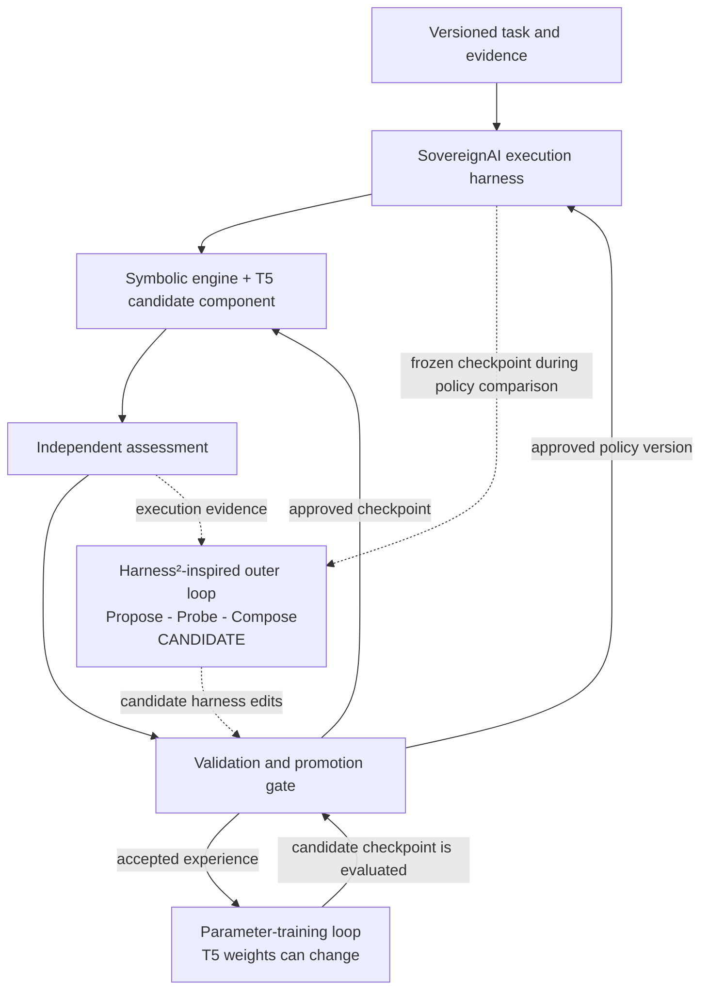

# Harness² assessment for SovereignAI

Reviewed **29 October 2026**, following the user's suggestion. Status: **candidate source of orchestration ideas and possible later integration; not installed, selected as a dependency, or tested locally**.

## Recommendation

Use Harness² as a reference for the outer strategy-improvement loop. Keep SovereignAI's core Python 3.11 harness, explicit learning contracts, independent evaluators, and neural-training loop. Decide between a small native implementation of the relevant pattern and an isolated upstream integration after a bounded prototype demonstrates value.

Do not describe Harness² as an engine that independently learns English from Unicode or trains random T5 weights. The repository explicitly keeps model weights fixed while improving the surrounding harness. Its model-backed research configurations use existing language models. This is a different optimization target from learning model parameters. [Official repository](https://github.com/google-research/harness2), [research paper](https://arxiv.org/abs/2610.14224).

## Verified upstream facts

- The framework uses task-level Propose–Probe–Compose refinement and a persistent improvement harness that carries experience to later tasks.
- It offers sequential and parallel recursion. It includes a local deterministic demo that requires no model credentials; the entire framework should therefore not be described as inherently requiring a remote LLM for every use.
- The inspected package is version 0.1.0 with `requires-python = ">=3.12,<3.14"`; the package metadata does not support our Python 3.11 environment. [Package metadata](https://github.com/google-research/harness2/blob/main/pyproject.toml).
- The documented benchmark environment is Linux with Python 3.12; Python 3.13 is also supported by the package. Provided model configurations use Vertex-hosted executors/improvers/judges. The demo is a separate route. [Setup guide](https://github.com/google-research/harness2/blob/main/docs/SETUP.md), [demo entry point](https://github.com/google-research/harness2/blob/main/harness2/cli/demo.py).
- The repository uses Apache 2.0 for its own code, with separate upstream terms for included third-party material, and says it is not an officially supported Google product. Inspect and pin the exact code before reuse. [Repository license and disclaimer](https://github.com/google-research/harness2#license).

This was a targeted read of documentation, metadata, and the demo entry point. It was not a complete code audit, compatibility test, or replication of reported results.

## Which SovereignAI layers it could help

| Layer | Potential contribution | Work still required |
|---|---|---|
| Strategy proposals | Propose small alternative execution policies | Define allowed edits to typed policy objects and explicit budgets |
| Experiment execution | Run baseline and candidate policies on comparable tasks | Adapt our grounded task runner; pin model checkpoint, inputs, seed and resource budget |
| Comparison and composition | Compare outcomes and combine useful changes | Independently evaluate combined changes; do not assume individually useful edits compose safely |
| Experience memory | Carry supported lessons into later tasks | Map artifacts to Silicate records and Neo4j with source/evidence dependencies |
| Scheduling and resume | Inform bounded experiments and persistent run state | Verify recovery semantics and integration with our event/checkpoint contracts |

It does not supply our Unicode registry, Silicate kernel, seed compiler, lexical grounding, grammar learner, T5 weight-training implementation, or English mastery criteria.

## Proposed adaptation

This is a SovereignAI design proposal inspired by the framework, not a description of upstream behavior:

1. Select one supported task and an immutable baseline harness version.
2. Freeze the model checkpoint, permitted evidence, and task inputs while comparing harness candidates.
3. Generate a small, bounded policy edit. During bootstrap, use engineered rule-based proposals; after capability is demonstrated, the local learner may propose candidates.
4. Run baseline and candidate executions and preserve their complete relevant evidence.
5. Compare them with independent executable checks and, where needed, criterion-bound Yes/No/Think better assessment.
6. Compose promising edits only as a new candidate, then run fresh validation and retention tasks on that combination.
7. Promote or reject the version through the existing gate. Store lessons as scoped evidence-supported assertions, not universally true rules.

Candidate policies could change retrieval budgets, ordering of permitted operations, or practice selection within fixed limits. They cannot change canonical identity rules, teacher authority, evaluator access, hidden tests, feedback semantics, or maximum resource limits. The outer loop is not permission for unrestricted host-code editing or execution.

The paper studies refinement without ground-truth verifiers at task time. SovereignAI still requires independent evidence before promoting learned knowledge or policy changes. A model's comparison of its own outputs is useful as a proposal, not sufficient proof of correctness. [Research paper](https://arxiv.org/abs/2610.14224).

## Two distinct improvement loops

During a neural-training experiment, keep the accepted harness version fixed. During a harness experiment, keep the neural checkpoint fixed. This makes it possible to attribute improvement and regression to the change being tested.

## Python and deployment options

The current SovereignAI Python 3.11 environment remains unchanged. Two possible future paths are:

- Implement the narrow orchestration pattern natively in Python 3.11 using our own interfaces. Any reused source still needs license attribution and compatibility review; removing the upstream version constraint is not proof of compatibility.
- Evaluate a pinned upstream checkout in an isolated Python 3.12/3.13 worker, using its documented Linux benchmark environment where relevant. Exchange versioned requests/results with the Python 3.11 core through a defined boundary. This is proposed additional work, not a tested integration.

The deterministic demo would be a useful initial upstream experiment because it avoids pretrained-model calls. Before using model-backed executors or judges in SovereignAI learning, they would need to satisfy the existing no-pretrained-model boundary; the supplied configurations do not satisfy it automatically.

## Next decision evidence

An integration decision requires a pinned source revision, reviewed scope/license, a successful isolated demo or native prototype, a deterministic task adapter, an assessment adapter, and comparison with the simple custom harness. Record time, memory, task success, feedback cost, reproducibility and failure recovery. No benchmark gain from the upstream paper is treated as a prediction for an untrained SovereignAI model.

Files inspected through the connected GitHub tool were `README.md`, `pyproject.toml`, `docs/SETUP.md`, `docs/EXPERIMENTS.md`, and `harness2/cli/demo.py`. Reads used the upstream default branch; these observations are dated evidence, not an implementation pin.

## Version 0.3 mathematical experiment boundaries

The [AX01–AX12 adaptation](MATHEMATICAL_EXTENSIONS.md) supplies candidate experiment families, not new permissions for the improver. A native or Harness²-inspired loop can propose only the parameter changes listed in a frozen experiment contract—for example, a retrieval budget or a candidate rank within fixed limits. It cannot change the exact record format, introduce hidden source data, reinterpret feedback, or alter validation thresholds.

Compare one representation/index change with fixed model and harness versions. Compare one neural parameterization with fixed accepted retrieval and harness versions. Evaluate composed changes again rather than assuming separate gains add together. Every candidate references the source/artifact/checkpoint versions and its rollback state. The [register](../experiments/mathematical_extensions.toml) is inactive and is not an upstream Harness² configuration file.
