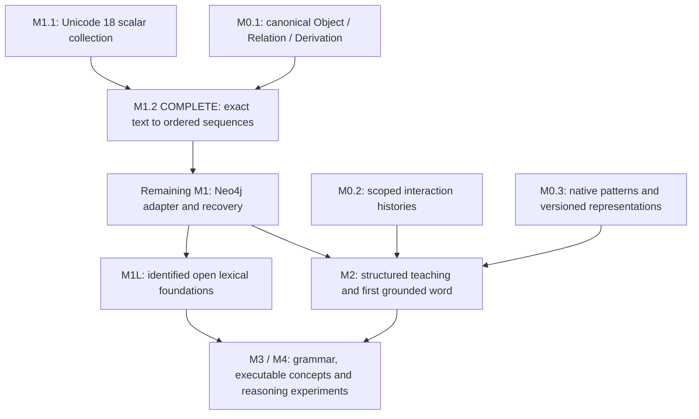

# Approved M1.2: reversible Unicode tokenization and ordered composition

Prepared and completed **30 October 2026**. **Status: complete within the approved scope.** The user explicitly approved M1.2 and requested that the development API author the implementation while Codex monitors, inspects and verifies the work. The [implementation guide](UNICODE_SEQUENCES.md) and [verification receipt](../manifests/m1-2-verification.json) record 170 passing tests, four reproducible artifacts and nine bounded development requests. The proposal below preserves the scope and acceptance criteria; broader M1 and language-learning work remain pending.

## Goal and roadmap

Turn exact UTF-8 input into existing Unicode 18 scalar Object references, compose them into an immutable ordered Sequence Object, and reconstruct the original bytes after persistence and restart. This is the next bounded slice of M1's tokenizer/sequence requirements, following completed M1.1 and the M0.3 binary foundation. It prepares the written-form side of M2's first grounded word.

Build numbers identify slices of their parent milestones: M0.3 does not require the next slice to be M0.4. Remaining general foundation and scaling work can be scheduled when its consumers need it. This recommendation follows the first useful M0–M2 vertical slice in [DESIGN_PLAN.md](DESIGN_PLAN.md#19-implementation-milestones-and-deliverables).

M0.3's [source-alignment update](BINARY_FOUNDATION.md#source-alignment-and-remaining-concept-learning-work) keeps native binary concepts independent of English labels. M1.2 adds a text interface; assigning meanings, learning transformations and improving reasoning remain separate measured tasks.

## Dependency check

The [preflight receipt](../manifests/m1-2-preflight.json) records the local checks. These checks establish compatibility and the existing baseline, not that the proposed implementation already works.

| Dependency | Checked state | Consequence |
|---|---|---|
| Python environment | CPython 3.11.18; all seven direct pins match installed versions; all 25 installed distributions pass the package compatibility check | Reuse the current environment |
| Lockfile | Offline lock check resolves the existing 27 conditional/resolved entries successfully | No dependency upgrades planned |
| Canonical three-primitive codec | Existing strict validation and ordered-payload fixtures pass | Reuse the selected format; register the production Sequence schema in this slice |
| Unicode collection | Full verification passes: 310,341 scalar Objects plus six declarations | Resolve symbols against this collection; keep its IDs fixed |
| M0.2 and M0.3 | Saved active store and both binary artifacts replay successfully; all 103 existing tests and Ruff pass | Preserve compatibility; no new learning loop is needed for text composition |
| Unicode properties | Python's built-in Unicode database reports 14.0.0; project data is 18.0.0 | Use strict UTF-8 decoding and the pinned scalar registry. Defer normalization and grapheme algorithms to separately tested views |
| Neo4j | Driver 6.4.0 installed; no project server/adapter integration has been established or live-tested | Use bounded local prototype storage for this slice; Neo4j remains separate M1 work |
| Rust source reuse | Existing source review records unresolved upstream licensing and production integration | Use the independent Python implementation; do not vendor additional upstream source in this slice |

No new package, model framework, hosted service, dictionary download, GPU or API credential is required. No live database, vulnerability or load audit is implied by the preflight checks.

## Proposed scope and contracts

1. **Finite text registry.** Declare source-bytes, ordered scalar-sequence, span-map, tokenization-result/error, operation/rule and relation-type Objects as needed. All Object type/definition/schema handles must resolve to declaration Objects. Reuse Unicode declarations without changing them. These are engineering structures, not English definitions.
2. **Strict scalar tokenizer.** Accept exact byte input through a file/library interface, decode strict UTF-8, resolve each scalar to its existing Object ID, and retain scalar index plus half-open byte start/end offsets. No pretrained tokenizer, BPE vocabulary, case folding, trimming or implicit normalization. Inspect controls/invisible symbols using escaped output.
3. **Ordered composition.** Register the existing payload convention: `u64 child_count` followed by the ordered 32-byte scalar IDs. Its declared type/profile fixes the element contract. Produce one membership Relation per position with explicit ordering. Repeated scalars share their scalar Object but occupy different positions. `ab` and `ba` have different Sequence IDs.
4. **Source and occurrence mapping.** Preserve source bytes in a typed Object and positions in a span-map Object. A position identifies an occurrence within that source; it is not a new scalar identity or an independent interaction event. Repeating the same import is idempotent. Later event-specific histories belong to the interaction/teaching harness.
5. **Verifiable operations.** Record tokenization and composition with Derivations identifying source inputs, operation/rule versions and outputs. Re-execution must reproduce bytes, spans, ordered edges and IDs. Hash validity alone does not establish correct composition.
6. **Local persistence and CLI.** Publish a bounded canonical record collection, registry, rebuildable lookup index and manifest into a new directory after verification. Add tokenize/compose, inspect, reconstruct and verify commands. Reopening or restoring the artifact must preserve IDs and exact bytes. Keep the immutable Unicode source collection unchanged.

Initial bounds are **4,096 source bytes and 1,024 scalar positions per request**, with explicit record/output budgets within the existing 1 MiB-record and 4,096-reference limits. Source input must be bounded before allocating or parsing. Empty input is a valid empty sequence. Long text, nested phrase structures and paged sequences require a later version; limits must never be silently raised to fit an example.

The accepted scalar repertoire is the existing assigned Unicode 18 collection, including its controls and private-use scalars. Valid scalars absent from that collection (including unassigned values/noncharacters) produce an explicit unsupported-scalar result with the exact position. Malformed UTF-8 or a surrogate supplied through a library interface produces an explicit validation error. Retain submitted bytes as source evidence in the bounded import result; do not substitute a replacement character, silently discard input or publish a successful partial sequence. A later repertoire extension requires declared policy and its own compatibility checks.

Combining marks, variation selectors and joiners retain their distinct scalar positions. The precomposed and decomposed spellings of the same rendered glyph can have different Sequence IDs; the original byte identity is authoritative. Grapheme grouping and normalization remain explicit future derived views using Unicode 18 conformance data. This slice does not claim those algorithms are implemented.

M0.3 concept IDs and local prefix codes keep their existing contracts. A Sequence is a written-form representation, not automatically a learned concept, active group, word boundary or neural token. There is no automatic fitting, history pooling or transfer of meaning into member scalar Objects. A future binary adapter must declare its encoding, evidence roots and scope and respect M0.3's separate 4,096-bit observation limit; it cannot treat the text byte budget as an authorized binary-observation budget.

## Demonstration and completion evidence

Use `letter` as an engineering fixture: `l, e, t, t, e, r` gives six positions and four distinct scalar Objects. Show its ordered membership edges, byte spans, composition receipt, saved artifact and exact reconstruction after a fresh-process restart. The fixture supplies no accepted dictionary meaning or language-learning evidence.

Acceptance requires:

- Same content/profile produces the same Sequence ID across processes and independent rebuilds; changed order or repetition changes identity.
- Repeated symbols, empty input, multibyte scalars, combining marks, a joined emoji sequence, whitespace and controls reconstruct exactly with correct byte spans.
- Malformed UTF-8, surrogate input, unsupported repertoire values, missing/mistyped references, altered spans/order, corrupt artifacts and exceeded budgets fail explicitly.
- All declarations resolve, Relations agree with the canonical ordered payload, and Derivations pass operation replay. Extra hash-valid but unexplained records cannot make an invalid artifact valid.
- Interrupted publication exposes no complete artifact until verification succeeds; retry does not overwrite an existing incompatible artifact. Export/restore into a fresh directory preserves content identity.
- Existing 103-test baseline plus focused composition/property/recovery tests pass; Ruff and dependency consistency checks pass. The verification receipt records actual test counts and artifact hashes.

## Expected deliverables and API use

Expected new areas: `tools/unicode_sequences.py`, `tests/test_unicode_sequences.py`, `fixtures/unicode-sequences-v1/`, `docs/UNICODE_SEQUENCES.md`, `manifests/m1-2-verification.json` and `data/objects/sequences/m1-2/`. Update the existing contract, architecture and ledger documentation. Minimal shared-helper changes are allowed only to support this scope while preserving existing wire formats and identities. Exact file factoring can follow implementation needs.

The original proposal allowed one optional development review. The approval message explicitly expands that role: the API will author the implementation and tests in separately inspected requests, while Codex applies reviewed changes and performs local verification. Each request retains the helper's 48,000-character input limit, 4,096-output-token hard cap, 60-second timeout, no automatic retries and development-only boundary. Follow-up corrections are explicit and inspected, not an unattended loop. Record actual requests and token usage in the build receipt. No new credential is needed; API output cannot become learner seeds, meanings, learning examples or authoritative grades. Proposal preparation used no paid API request.

The approved slice would deliver a reversible symbolic text substrate. Meaning attachment, dictionary import, English grammar, expert reasoning, Yes/No/Think better teaching, live Neo4j/Spanner integration, learned binary operations and numeric/tensor streaming remain separately approved work. M0.3's accepted scaling architecture is retained for those later consumers.

**Approval received:** Build M1.2 as scoped above, with API-led implementation and Codex inspection as explicitly requested by the user. Additional roadmap builds remain subject to [BUILD_WORKFLOW.md](BUILD_WORKFLOW.md).
