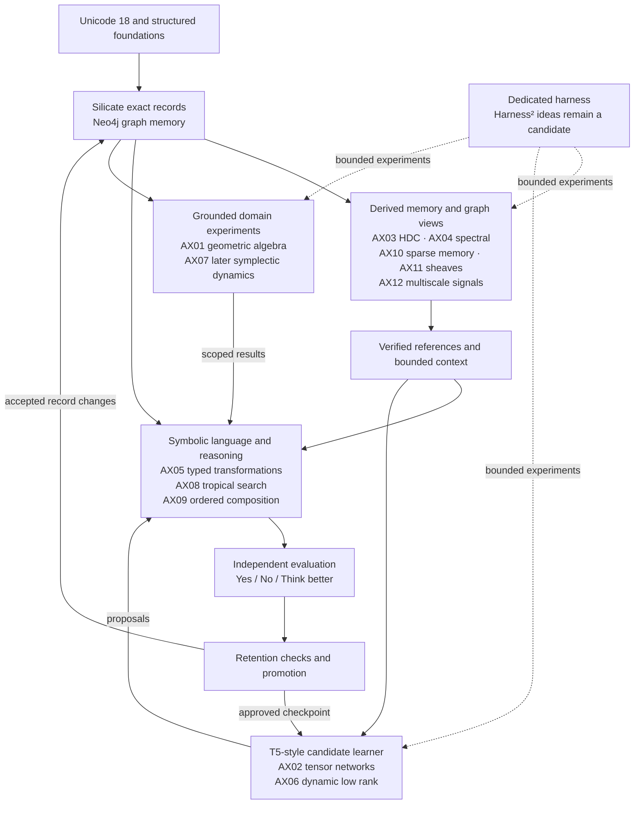

# Twelve mathematical directions adapted to SovereignAI

Version 0.3 — **30 October 2026** — Architecture and experiment design; algorithms are not implemented.

## 1. Source, scope, and decisions

This adapts all twelve directions in the [user-provided shared response](https://chatgpt.com/s/t_6ae39bbc3ef48191a3d8169ab041991d). The public page's embedded data exposed the response in plain-text and presentation forms. Both contain the twelve-item list; earlier conversational context was not needed to identify it. Page scripts were not executed. The source's potential rankings are opinions, not measured results for SovereignAI.

These are cross-cutting techniques assigned to existing components, not twelve extra mandatory layers. Their identifiers, AX01–AX12, preserve the source order. The machine-readable [experiment register](../experiments/mathematical_extensions.toml) records all twelve as inactive design entries. It is not loaded by a running harness.

The chosen foundation remains Unicode 18, Object/Relation/Derivation, Python 3.11, Neo4j initially, a symbolic baseline, and a randomly initialized T5-style experiment. Harness² remains a candidate for outer strategy optimization. No pretrained representations or additional external training corpus are introduced by this adaptation.

**Exact records remain authoritative.** Numeric representations are versioned derived artifacts used for candidate retrieval, search, diagnostics, or neural computation. Approximate similarity, minimum cost, geometric invariance, and small consistency residuals do not establish factual truth. Every accepted change still passes the existing assessment and promotion contracts.

Using mathematics inside the software does not mean the learner has learned mathematics. Subject instruction remains English first, then mathematics after its gate. Teacher-supplied meanings and approved experience remain the learning sources.

## 2. Mapping to the current architecture

Layer numbers refer to [ARCHITECTURE_STATUS.md](ARCHITECTURE_STATUS.md).

| ID | Source direction | Placement in SovereignAI | Earliest useful experiment |
|---|---|---|---|
| AX01 | Geometric algebra | Grounded meaning and spatial transformations; layers 8, 11, 18 | After explicit spatial grounding and an independent scene checker exist |
| AX02 | Tensor networks | Factorized T5 weight/embedding components; layers 9, 16 | After a working dense neural baseline and resource measurements |
| AX03 | Hyperdimensional computing | Role-sensitive associative retrieval; layers 6, 8, 10 | After exact graph retrieval works on grounded examples |
| AX04 | Spectral graph theory | Bounded graph-context selection and structural diagnostics; layers 6, 10, 13 | After graph snapshots, projections, and retrieval baselines exist |
| AX05 | Operator learning | Typed reusable transformations in the reasoner; layers 8, 11, 16 | Program composition after the interpreter; genuine function-space operator learning later |
| AX06 | Dynamic low-rank subspaces | Adaptive parameter capacity in our own neural component; layers 9, 16 | After dense and fixed-rank baselines plus retention tests |
| AX07 | Symplectic geometry | Later physical-dynamics/world-model component; layers 11, 18 | After English, mathematics, and appropriate physics foundations |
| AX08 | Tropical linear algebra | Cost-based parsing, morphology, and bounded plan search; layers 4, 8, 11 | After grammar candidates and explicit cost semantics exist |
| AX09 | Noncommutative algebra | Ordered sequence and typed operation composition; layers 3, 4, 8, 11 | Exact order contracts in M0/M1; learned representations later |
| AX10 | Sparse associative memory | Cue-based experience/meaning retrieval; layers 6, 10, 13 | After durable objects, occurrence records, and exact retrieval baseline |
| AX11 | Sheaf-based linear algebra | Context-sensitive compatibility diagnostics; layers 6, 8, 11, 15 | After explicit assertion/constraint checking and context-separated graph views |
| AX12 | Multiscale wavelet representations | Multi-resolution diagnostics and retrieval over graph signals; layers 6, 10, 13, 15 | After signals, graph snapshots, and simple aggregate baselines exist |

## 3. The twelve adaptations

### AX01 — Geometric algebra for grounded spatial meaning

**Implementable proposal:** add typed geometric values and operations for a small teacher-approved scene domain: positions, directions, rotations, and relations with explicit reference frames. Store their source observations, units, basis, algebra signature, and operation contracts as ordinary Silicate records. Use a fixed small algebra appropriate to the scene, rather than assigning a high-dimensional Clifford algebra to every English word.

**First experiment:** compare a geometric-algebra representation against ordinary coordinates and transformation matrices on the same grounded descriptions. Check translation/rotation behavior where the task actually has that symmetry, plus composed operations and unfamiliar entity combinations. Left/right statements require an explicit reference frame; invariance must not erase it.

**Acceptance evidence:** scene-answer correctness, transformation-composition error, sample cost, peak memory, and wall-clock time. Canonical referent IDs must remain recoverable. A win on geometry does not demonstrate general English reasoning.

**Boundary:** geometric products have a natural role in geometric data. The shared response's language-semantics proposal is a research branch, not established superiority. Multivector dimension grows as (2^n) in a nondegenerate (n)-generator Clifford algebra, so arbitrary embedding dimensions are inappropriate. [GATr primary research](https://arxiv.org/abs/2305.18415), [2026 survey](https://arxiv.org/abs/2610.30121), [functional language-semantics proposal](https://arxiv.org/abs/2604.25902).

### AX02 — Tensor networks for a measured neural compression experiment

**Implementable proposal:** once a dense T5-derived baseline works, factor one selected feed-forward or embedding component using a tensor-train/matrix-product-operator representation. Record the tensorization shape, axis order, factor cores, bond ranks, contraction algorithm, and artifact hashes. Begin with one replaceable component, not an entire architecture rewrite.

**First experiment:** compare dense, ordinary matrix low-rank, and tensor-network variants using the same permitted data, task splits, tuning budget, and reported compute. A factorized model can be initialized from scratch; any later conversion uses only our own trained checkpoint. Conversion and retraining costs count in the report.

**Acceptance evidence:** parameter and optimizer-state bytes, actual peak training/inference memory, latency, semantic task performance, and retention. Parameter compression alone does not prove speedup. Static tensor rank is tested before adaptive rank and before combining AX02 with AX06.

**Boundary:** factorized weights are model artifacts; graph records, assessments, and canonical identities remain exact. Tensor decompositions are established methods, but their benefit on this architecture remains unmeasured. [Tensorizing Neural Networks](https://arxiv.org/abs/1509.06569), [2026 tensor-methods survey](https://arxiv.org/abs/2608.30505).

### AX03 — Hyperdimensional computing for compositional retrieval

**Implementable proposal:** derive reproducible random bipolar or binary code vectors from opaque canonical IDs, using a versioned seed and codebook algorithm. Encode roles and positions explicitly, then combine bound role/filler pairs into a retrieval signature. The vectors provide candidate associations; each result resolves to exact graph records for filtering and use.

For example, `agent:A, action:chase, patient:B` and the role-reversed event must receive distinguishable signatures. Elementwise bipolar binding is commutative by itself; role separation or position permutations are essential. Bundling is lossy and does not permit unlimited exact recovery.

**First experiment:** cue completion over approved scene records with novel combinations, repeated symbols, swapped roles, and controlled distractors. Compare against exact indexes, sparse retrieval, and random retrieval at matched memory/query budgets. Sweep dimension and memory load on development data before audit.

**Acceptance evidence:** recall@k, false matches, abstention under interference, update/rebuild cost, and downstream task correctness. No vector distance is interpreted as a semantic fact or calibrated probability without separate evidence. Changing the codebook invalidates dependent indexes. [HDC/VSA survey](https://arxiv.org/abs/2111.06077).

### AX04 — Spectral graph theory for context selection

**Implementable proposal:** construct a bounded, explicitly versioned projection of a typed knowledge subgraph. For a first spectral experiment, use a symmetric nonnegative adjacency matrix and (L=D-A). Store relation filters, weight semantics, context/sense filters, node ordering, snapshot, and any symmetrization policy. The directed, typed source graph remains intact.

Use diffusion or spectral features to propose relevant neighborhoods and characterize structural bottlenecks. Prefer sparse polynomial methods or local subgraphs when a full decomposition is unnecessary. Refresh derived state when its declared dependencies change; do not reuse stale eigenvectors as stable semantic identities. Eigenvector signs and repeated-eigenvalue basis choices need explicit handling.

**First experiment:** compare context selection against exact-ID lookup and bounded typed neighborhood traversal. Deliberately add high-degree irrelevant nodes, disconnected components, and relation-direction contrasts.

**Acceptance evidence:** relevant-record recall, downstream answer accuracy, omitted-evidence rate, query latency, rebuild cost, and robustness to graph changes. Structural proximity ranks candidates; it does not establish entailment. [Graph spectral constructions and sparse approximation](https://arxiv.org/abs/0912.3848).

### AX05 — Typed transformation learning, with genuine neural operators kept distinct

**Near-term adaptation:** extend the already planned rule interpreter with typed reusable transformations. Each operation has input/output types, applicability conditions, permitted effects, and a verifiable result contract. First implement the primitives; then search for useful compositions from approved examples. Learned compositions are versioned candidate programs, never arbitrary host code.

**First experiment:** after the relevant grammar is taught, learn or reuse a transformation such as question construction only within its supported grammatical class. Check role preservation, scope, negation, and invalid preconditions. Include transformations that should be rejected; do not generalize one rule to every English clause.

**Acceptance evidence:** correctness on unseen compositions, rule/program length, search expansions, failure under violated preconditions, and retention. Compare with fixed rules and example memorization.

**Terminology boundary:** typed program induction is an adaptation of the transformation idea; it is not an implementation of a neural operator. Neural operators learn maps between function spaces. A genuine AX05 neural-operator branch is deferred until a suitable mathematical/scientific subject supplies function-valued observations and independent reference solutions, including tests across discretizations. [Neural Operator primary paper](https://arxiv.org/abs/2108.08481).

### AX06 — Dynamic low-rank capacity in our own neural model

**Implementable proposal:** after dense and fixed-rank training baselines, test a selected weight parameterization (W=USV^\top), allowing rank changes at explicit checkpoints within a hard memory budget. Define when to grow or truncate rank, how to initialize new directions, and how to migrate optimizer state and replay retained tasks.

**First experiment:** train on a controlled sequence of English task families and compare dense, fixed-rank, and adaptive-rank variants. Selection uses the development stream; promotion uses separate validation. Do not choose rank based on hidden audit answers.

**Acceptance evidence:** accuracy and retention versus actual time, memory, parameter count, and rank-change overhead. Record the entire rank schedule. Reject oscillating or numerically unstable changes even if they reduce stored parameter count.

**Boundary:** adapting low-rank weights is different from tensor-network factorization. Low-rank adapters on a frozen randomly initialized base are not assumed to acquire language effectively. If later using adapters, the base must be our own trained model and the comparison must account for its prior training. [Dynamic low-rank training research](https://arxiv.org/abs/2205.13571).

### AX07 — Symplectic geometry for a later dynamics domain

**Deferred adaptation:** add a world-model experiment only after the curriculum reaches appropriate mathematics and physics. Use explicit state variables such as position/momentum, a declared Hamiltonian or simulator, and a map designed to preserve the relevant symplectic structure.

**First experiment:** compare a symplectic numerical baseline, an ordinary learned predictor, and a small structure-preserving learned map on trajectories generated from approved physical definitions. Hold out initial conditions and rollout horizons. Record time-step and reference-solver accuracy.

**Acceptance evidence:** trajectory error, long-horizon drift, numerical structure checks, and compute cost. Energy error is measured separately: a symplectic discrete method does not in general preserve energy exactly.

**Boundary:** this is not a general solution to forgetting, long-term semantic memory, or stable English learning. No symplectic component enters the initial English engine on the strength of that analogy. [SympNets primary research](https://arxiv.org/abs/2001.03750).

### AX08 — Tropical algebra for cost-based grammar and plan search

**Implementable proposal:** use the min-plus semiring for ranking permissible candidate paths: alternative costs combine with `min`, and successive costs combine with `+`; unreachable paths have cost (+\infty), and the empty path has cost zero. This fits morphology/segmentation lattices and selected grammar or plan-search problems.

**First experiment:** begin with a small acyclic lattice or explicitly bounded search space. Costs come from declared rules or logged learned estimates. Compare dynamic-programming results with exhaustive enumeration on small cases, then benchmark against ordinary bounded search. Handle ties and return alternatives rather than erasing ambiguity.

**Acceptance evidence:** optimal permitted-path agreement, preserved source spans, truncation reporting, latency, and downstream meaning preservation. Use nonnegative costs initially; define cycle behavior before any cyclic extension.

**Boundary:** a minimum-cost parse or plan is not necessarily true or correct. The candidate still needs semantic and task checks. Weighted finite-state components do not represent all English grammar; richer parsing remains necessary where required. [OpenFST shortest-distance documentation](https://www.openfst.org/twiki/bin/view/FST/ShortestDistanceDoc), [Mohri's semiring-based algorithms](https://research.google/pubs/generic-e-removal-and-input-e-normalization-algorithms-for-weighted-transducers/).

### AX09 — Noncommutative composition as an early exact invariant

**Immediate design integration:** preserve order in both text and operation programs. Sequence payloads commit to ordered child IDs; operator ASTs commit to application order. Define composition direction explicitly so the human display and executor agree. No commutative set/bag representation becomes the identity of a sentence or derivation.

**First experiment:** apply `append_a` then `append_b` to the empty sequence and compare it with the reversed program. The resulting `ab` and `ba` must remain distinct. Later grounded tasks test role reversal and operator scope with independent checks. Some operations legitimately commute; the system must not assume every distinct pair is noncommuting.

**Acceptance evidence:** exact composition/reconstruction, ordered-program replay, and preservation of role/scope contrasts. This belongs in M0/M1 contracts before any neural experiment. Learned matrix-valued or other algebraic representations are optional later branches, measured against the exact AST interpreter.

**Boundary:** order sensitivity is necessary in these tasks, but it does not alone supply meanings, logic, or intelligence. [Primary research on matrix/vector semantic composition](https://aclanthology.org/D12-1110/).

### AX10 — Sparse associative retrieval backed by exact records

**Implementable proposal:** begin with sparse typed cues, exact postings, and content-addressed payload references. The cues identify task context, roles, senses, and applicable rules. After this simple baseline, test a sparse-distributed or sparse correlation-memory representation as a replaceable index.

**First experiment:** incrementally store approved episodes, retrieve from incomplete/noisy cues, introduce competing senses and distractors, then supersede or withdraw selected associations. Retrieval must respect the requested snapshot and return record IDs with provenance, not newly invented facts.

**Acceptance evidence:** precision/recall@k, false association rate versus memory load, update cost, latency, bytes per stored item, and recovery/rebuild behavior. Test AX03 alone, AX10 alone, and their combination so their contributions are identifiable.

**Boundary:** an inverted index is the baseline, not a claim that a Kanerva-style memory has already been implemented. Sparse and distributed memories have interference/capacity limits. Canonical records and assessment history survive index pruning; repeated retrieval does not count as fresh evidence. [Kanerva's sparse distributed memory technical report](https://ntrs.nasa.gov/api/citations/19920019632/downloads/19920019632.pdf).

### AX11 — Sheaf-based diagnostics for scoped compatibility

**Implementable proposal:** after exact constraint checks exist, create small context-indexed local representation spaces and explicit restriction maps to their overlaps. A candidate disagreement score compares two mapped representations in a shared edge space. Record each space, map, grounding, source context, and version.

For an edge joining contexts (v,w), an illustrative residual is (r_e=\rho_{v,e}x_v-\rho_{w,e}x_w). A sum of squared residuals can prioritize inspection. It is not a truth test. Separate senses, time intervals, viewpoints, and uncertainty before checking compatibility.

**First experiment:** construct teacher-approved compatible/incompatible descriptions with known scope. Include same-spelling/different-sense cases that must remain separate. Compare against explicit typed constraint checking and ordinary graph diffusion.

**Acceptance evidence:** detection of actual conflicts, false alarms on legitimate context differences, preservation of source distinctions, and cost. Guard against the trivial solution of collapsing all values or maps to zero; evaluate with fixed/anchored maps or declared non-collapse constraints.

**Boundary:** sheaf consistency can expose representation mismatch, but agreement does not establish that shared claims are true. No source is overwritten merely to minimize a residual. [Neural Sheaf Diffusion primary research](https://arxiv.org/abs/2202.04579).

### AX12 — Multiscale wavelet diagnostics and context selection

**Implementable proposal:** begin with explicit per-rule/per-concept measurements and simple hierarchical aggregates. When these exist, test graph wavelet filters at several scales on a frozen projection, for example (g(tL)x), where (x) is a declared numeric signal and (t) a declared scale. Reuse the AX04 projection contract, without requiring its retrieval algorithm.

Signals might describe counts of observed task failures or evidence coverage. They must not be arbitrary code-point values treated as meanings. If calculating failure rates from Yes/No assessments, retain the criterion and denominator; Think better remains a separate unresolved/revision count.

**First experiment:** compare wavelet-selected practice/context against exact neighborhoods and simple aggregates. Plant or generate independently labeled local versus broad performance gaps and test whether the selector finds them without hiding rare critical failures.

**Acceptance evidence:** diagnostic precision/recall, context/practice benefit, approximation or reconstruction error where applicable, memory, and refresh cost. Preserve leaf evidence, including negation and role-reversal failures, even when a broad summary looks good.

**Boundary:** word/phrase/sentence grouping alone is not a wavelet transform. A wavelet experiment needs a defined signal domain, graph/filter/boundary conventions, and measurable behavior. [Spectral graph wavelets and Chebyshev approximation](https://arxiv.org/abs/0912.3848).

## 4. Shared implementation contracts

These extend [CONTRACTS.md](CONTRACTS.md); every family is still an Object, and record-to-record links remain Relations. Computational receipts use Derivations or the existing receipt-reference pattern where needed.

| Object family | Required content | Boundary |
|---|---|---|
| Algebra profile | AX identifier, domain/types, operations, algebra/signature or semiring, basis/shape, numerical conventions, implementation version | Names alone do not implement operations |
| Projection specification | Source snapshot, permitted relation/context filters, ordered record IDs, weights, seed/codebook, shape, algorithm and dependency versions | No hidden evaluator data or unlogged source exposure |
| Derived artifact | Projection reference, content hash, format/dtype, external tensor/index blob reference, build receipt, source dependencies, approximation bounds or measured residuals | Derived artifacts cannot replace exact records or self-promote claims |
| Operator candidate | Typed AST/representation, application order, pre/postconditions, scope, resource bounds, evidence roots | Executed only through permitted operations; validity is scoped |
| Experiment contract | Baseline/candidate, data-exposure manifest, task splits, seeds, budgets, metrics, acceptance limits, permitted changes | Frozen before candidate comparison; no retrospective target changes |

**Artifact lifecycle:** `planned → candidate → evaluated → accepted` or `rejected`; an accepted artifact can later be `stale` or `retired`. Mark an artifact stale when a declared dependency changes; rebuild, fall back to exact methods, or abstain. The learner cannot silently reuse an artifact from a different sense map, vocabulary, graph snapshot, or checkpoint.

**Numeric reproducibility:** record PRNG algorithm/state, ordering, dtype, backend/version, device, approximation settings, and tolerances. Hash stored artifact bytes for integrity. Do not round approximate numerical values into canonical identities or claim equal hashes across nondeterministic computations. Record semantic replay tolerances separately from exact byte verification.

**Storage:** keep records and artifact metadata in the graph; keep large tensors, decompositions, and indexes as versioned external blobs with hash references. Fetch verified exact records after approximate candidate retrieval. A lower similarity score, empty bounded search, or lost cache is not proof that knowledge does not exist.

## 5. Evaluation and rollout

All twelve directions are inactive. Add them only as their prerequisites become available:

1. **M0/M1 foundation contracts:** AX09 ordered composition; type/effect contracts supporting AX05; artifact boundaries for later numerical views. Complete the existing first vertical slice.
2. **M2 memory experiments:** establish exact retrieval, then AX10 sparse memory and AX03 HDC pilots on grounded tasks. Test them independently and in combination.
3. **M3/M4 grammar and reasoning:** AX08 cost-based search and AX05 program-composition learning. Consider AX04, AX11, and AX12 only with suitable graph/task measurements. AX01 requires an explicit grounded spatial task, not merely English labels for geometric objects.
4. **After a working T5 baseline, with M5/M6 evaluation:** AX06 fixed- then adaptive-rank experiments and AX02 tensor-network variants in separate comparisons. Introduce neither as a required initial T5 implementation.
5. **Later subject-specific work:** a true function-space AX05 neural operator and AX07 symplectic dynamics after the required mathematics/science foundations; advanced AX01 language semantics only as a separately evaluated research hypothesis.

For each pilot, freeze source exposure, learner snapshot, harness version, and audit boundary. Compare with the simplest applicable baseline using the same knowledge and feedback access; report actual compute and tuning costs. Candidate-selection validation is not the final audit. Small experiments begin with exact reference cases; generalization splits must hold out meaningful structures rather than only random seeds.

**Hard rejection conditions:** changed canonical content under an old ID; silent symbol/role/order loss; treating an approximate match as verified knowledge; hidden-data access; stale artifacts used as current without an explicit policy; duplicated assessment influence; or inability to restore the incumbent after a failed candidate. Task-quality and resource thresholds are declared in each experiment contract before running it; no universal accuracy percentage is invented here.

The harness may propose changes only within an experiment's allowed parameters. During a representation/index experiment, freeze model weights and the harness policy; during a model experiment, freeze the accepted retrieval and harness versions. A Harness²-inspired composer may suggest combinations only after single-component results, and a combination must pass a new independent evaluation. It cannot redefine feedback, overwrite evidence, or widen its own resource ceilings.

**Stop rule:** retain the simpler baseline when an extension adds cost without a reproducible relevant gain. A documented negative result satisfies an experiment, not the English mastery goal. None of the twelve methods guarantees expert reasoning, self-improvement, or unrestricted English competence.

## 6. What changed in version 0.3

All twelve source directions now have a component owner, scoped use, prerequisite, baseline, measurements, and promotion boundary. The plan, contracts, decision register, model choice, Harness² assessment, and architecture status link to this adaptation. Python dependencies, Unicode data, and the no-pretrained-model boundary are unchanged. No numerical algorithm, index, neural model, graph database, or learning loop was implemented by this documentation update.

Subsequent approved M0.1/M1.1 work implements the foundational AX09 order contracts and the initial Unicode Object collection. The twelve research experiments remain inactive; this does not establish the optional learned algebraic representations. See [FOUNDATION_CONTRACT.md](FOUNDATION_CONTRACT.md) and [the Object collection](../data/objects/unicode/18.0.0/README.md).
